<!-- Generated from docs/ux-surfaces.yaml by scripts/ux_surface_map.py. Do not edit: change the map and re-run. -->

# UX surface map: task-os

Every surface a person can reach in this app, each under a stable id that its root element carries as `data-surface`. Each area has a diagram of how its surfaces connect; a rounded node is a surface in another area.

The checklist of everything a person can see and do in task-os: every pane, drill-in, menu, sheet, dialog, gesture and key, with how it is reached, what is on it, what each control does and the decision behind it where one exists. [Views](views.md) tells the story of the main views in prose; this page is the exhaustive index, so a layout change can check every surface and not only the ones a reviewer happens to open. Behaviour that a surface only links to lives in its own doc (linked per entry).

**Keeping it true.** A change that adds, removes, renames or reshapes a user-visible surface (a pane, tab, sheet, dialog, popover, menu, menu item, Settings row, gesture or key) updates its entry in `docs/ux-surfaces.yaml` in the same change, with the entry's *why* when the choice was deliberate, and regenerates this page with `python scripts/ux_surface_map.py`; this page is never edited by hand. The rule is in `CLAUDE.md`.

**Ids.** `<area>.<surface>`, lowercase words joined by `.` or `-`, the same form the e2e `surface(page, "<id>")` hook takes. An id never changes when a title is reworded or entries are reordered, and one id names one surface even when it is drawn two ways (the date popover and the phone's date sheet are both `row.date`). The surface's root element carries the same id as `data-surface`; the vendored row menu builds its own element, so its call sites stamp the id on what `attach` returns. `scripts/ux_surface_ratchet.py` fails a surface root without an id, an id without an entry, an entry no element carries, an id on two roots, a link to an id with no entry and a page that is not what the map generates. It reads markup and JS, so the entries marked `none` and every screen or state with no root of its own are held by this map and the e2e walk alone.

## Ground rules

**Four destinations, one gear.** The nav is Today · Board · Time · Search. Settings is the header gear, one tap from every tab, and is not a tab. The Done journal is a pane with no tab. Time can be switched off (Settings → Available features), which removes its tab.

**Layout bands** (the same markup, three placements):

| Band | Condition | Nav | Lists | Task detail |
| --- | --- | --- | --- | --- |
| Phone | touch pointer, up to 520px | floating bottom pill, hidden under a modal | one column; task lists are inset rounded cards at the page gutter | full-screen sheet |
| Narrow or mid window | a mouse below 1100px, or a touch device wider than 520px | an inline tab bar pinned at the top | one column | full-screen sheet below 1024px, side panel or split from 1024px |
| Wide | 1100px and up with a mouse | left rail | Board and Today span the window; Time, Search and Settings keep a 772px measure | side panel (Board), split pane (Today) |

The 1024px breakpoint (side panel, split, a list scrolling inside its own box) is separate from the 1100px rail breakpoint, so a 1024 to 1099px window has the top bar and the split.

**Input modes.** A mouse or trackpad gets the completion circle and the **Move** verb on each row and right-click on a row. A touch screen has neither: a row swipes (right completes, left opens the date sheet) and the kebab holds everything else. The keyboard reaches every row action through keys and the palette, so no action is gesture-only. Drag-and-drop on the Board is mouse only.

**Gating.** Surfaces tagged for a feature block disappear when the block is off: Time (tab and Time categories row), Calendar lane (and Calendar row), Issue sync (and Issues row, drawer panel, issues scope), Email and folders (Capture, Email archiving, folder and email search), Local AI (Voice, AI Inbox triage, Triage), Mirror and backups. A Settings group whose every row is gated (Sync, Email) leaves with its label, and returns with the first row. `Available features` is itself a Settings group.

**Who the viewer is.** On the install's own PC (loopback) the viewer is the install owner with no credential. Any other device signs in at `/login` with a token or password and is the member that credential names; with team mode on, a team password plus a picked name signs in instead. A request with no credential from another device is refused. Surfaces that depend on this: the person row, Owner select, Mine/Everyone, Sign out, the name picker.

**Where state lives.** The filter, scope, person pick and search query ride the URL (see [Deep links](#deep-links-and-url-state)). Per-device choices live in `localStorage`: theme, text size, last tab, Board mode, Mine/Everyone, row-action choices. Nothing about a person is stored in the browser except those labels.

**Reading the diagrams.** Every list view feeds the one task row; the row feeds the one drawer; every picker that chooses a folder is the same folder picker; every date choice goes through the one date sheet (a popover next to the row on a mouse, a sheet on the phone).

## Keyboard map

| Key | Does |
| --- | --- |
| Tab / Shift+Tab | moves between rows and controls |
| Enter | opens the focused task |
| Space | ticks the row while Select mode is on |
| Ctrl+K / Cmd+K | the command palette |
| Esc | closes the topmost overlay, then the drawer, then leaves Select mode |
| `e` | complete (a recurring task rolls) |
| `1` `2` `3` | status inbox, todo, standby |
| `t` `w` | due tomorrow, due next week |
| `d` | the date sheet (Move…) |
| `p` | cycles priority |
| `e` with a task open in the drawer | opens that task's folder (the same key folder-explorer uses); in a text field it types the letter |
| `1` `2` `3` `t` `w` `p` with a task open | act on the open task, with Undo, as on a focused row |
| `x` · `d` · `c` · `l` with a task open | Done (closes the drawer, with Undo) · the calendar · the comment field · the folder and link editors |
| `z` | undo the last row action |
| `.` or the menu key | the row menu |
| `?` | the shortcuts sheet |

Row keys act on the focused row, or on the whole selection when tasks are ticked, and never fire while focus is inside a popover, menu, folder picker, toast or the bulk bar. Search, the palette, the parent picker, the folder picker and the comment composer have their own keys (listed on their entries).

## Deep links and URL state

| Form | Opens |
| --- | --- |
| `/` | the last tab, or Today on a fresh browser |
| `#task/<id>` | the drawer on that task |
| `#journal` · `#journal/task/<id>` | the Done journal, with the drawer |
| `#search` · `?q=<text>` | the Search tab and its query |
| `#settings` · `#settings/<row>` | Settings, a sheet open |
| `?status=&project=&sort=&updated=&due=&scope=&whose=&owner=&person=` | the same filtered view on every list tab |
| `/login?next=<path>` | sign-in, then back to the path |

An old `#table`, `#tree` or stored `table` / `tree` tab lands on Today; an old Archive tab link lands on Settings → Email archiving. Reading a link never rewrites the per-device Mine/Everyone pick.

## Empty, error and loading states

| Where | State | What shows |
| --- | --- | --- |
| Today, Board | no tasks at all | *Add your first task* with **Add a task**; the header reads *No tasks yet* (Time and Search keep their own line, Settings its page's) |
| Today (desktop) | nothing due or nothing selected | *Select a task to see its details* |
| Today | nothing due | header *Nothing due today*; horizons still list |
| Calendar lane | feed failing or partly unreadable | titled notice with cause and time; last good copy kept |
| Board | Triage unavailable | button disabled, reason on hover |
| Journal | nothing closed | says so and that nothing closed before the window |
| Time | nothing logged yet | the start list still works; Totals keep the comparison and guess card and show an empty state for the per-category bars |
| Search | an index off or failing | named, folded or in the danger tone, never an empty result |
| Settings | a service failing | its row value in the danger tone and the line under the page's title names it |
| Email archiving | no run, running, failed, not configured | the empty line, *Archiving…* with the button disabled, the reason |
| Any page | server unreachable | the header line and toasts report it |
| Sign-in | wrong secret | *wrong token or password*, nothing stored |

## Where this map was checked

Every surface above was opened on a disposable instance seeded only from the synthetic fixture (`tests/fixtures/seed.py`), with local fakes for the calendar feed, the folder service and the archiver, plus a second instance with team mode and seven members, and a third with no data and failing services. Desktop was a 1440 to 1920px window with a mouse. The phone was a 390 by 844 touch-emulated page. The e2e suite's per-story walks (`tests/e2e/`) cover the same surfaces with screenshots.

Not driven live in that walk, only read from the code and the docs: drag-and-drop between Board lanes (mouse only), the real feel of a swipe (the wiring was driven with synthetic touch events), voice dictation (needs a microphone and a transcription service), AI triage suggestions (needs the local model), creating and linking real forge issues, and a real mirror and backup folder (blanked on a disposable instance by construction).

Walked 2026-11-17 against build `3de7b58`, at widths 390, 1440, themes not recorded.

## Areas

| Area | Surfaces |
|---|---|
| [Chrome](#chrome) | 6 |
| [Today](#today) | 3 |
| [Board](#board) | 5 |
| [Shared strip above every list](#shared-strip-above-every-list) | 7 |
| [The task row](#the-task-row) | 6 |
| [Task drawer](#task-drawer) | 14 |
| [Time](#time) | 7 |
| [Search and command palette](#search-and-command-palette) | 3 |
| [Done journal](#done-journal) | 1 |
| [Settings](#settings) | 20 |
| [Sign-in and team name](#sign-in-and-team-name) | 2 |
| [Overlay catalog](#overlay-catalog) | 2 |

## Chrome

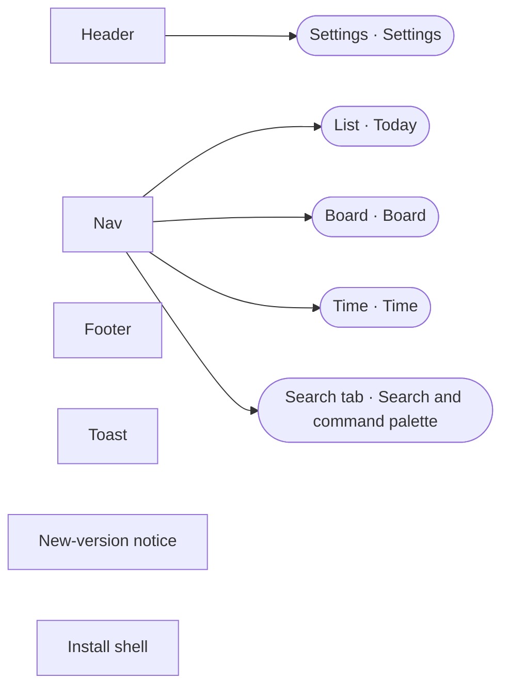

### `chrome.header` Header

- **Root:** `data-surface`
- **Reach:** always on screen, above every pane.
- **Holds:** a glyph and title naming the tab on screen, a status line beside it, the theme toggle, the Settings gear.
- **Does:** the gear opens the Settings page over the tab; the toggle flips light and dark.
- **States:** the status line names exceptions per view: Today *2 overdue · 3 due today* (or a muted *Nothing due today*), Board *4 in Inbox · 3 overdue*. On an install with no tasks Today, Board and the Done journal read *No tasks yet*, while Time and Search keep their own line, and *Server unreachable* replaces it when the server cannot be reached. The Settings page carries its own line (see Settings).
- **Why:** one persistent header row rather than a heading per pane.
- **Leads to:** [Settings](#settingspane-settings)

### `chrome.nav` Nav

- **Root:** `data-surface`
- **Reach:** always.
- **Holds:** four tabs with a glyph and label; the active one is tinted.
- **Does:** switches the pane; Arrow keys move between tabs. A deep link beats the remembered tab; the last tab is remembered per browser.
- **States:** Time absent when its block is off.
- **Why:** the fleet nav contract caps the bar at five; Settings is the rarely-used destination, so it is the gear.
- **Leads to:**
  - [List](#todaylist-list)
  - [Board](#boardpane-board)
  - [Time](#timepane-time)
  - [Search tab](#searchpane-search-tab)

### `chrome.footer` Footer

- **Root:** `data-surface`
- **Holds:** build line (identity of the running build), last child of the page, outside every card.

### `chrome.toast` Toast

- **Root:** `data-surface`
- **Reach:** after a user-initiated write or an error; passive status renders inline instead.
- **Holds:** one message at a time, pinned above the nav, with an optional **Undo (Z)** button.
- **Does:** Undo writes the inverse change; it and the `z` key expire together after ten seconds. Bulk results name any task that failed.
- **States:** neutral, or tinted for an error.

### `app.update-banner` New-version notice

- **Root:** `data-surface`
- **Holds:**
  - (stamped by the vendored build-watch component itself).
  - a banner offering **Reload** when the server moved to a newer build while the page stayed open (an installed phone app in memory across a restart). It is dismissible and never reloads by itself, so a typed draft survives.

### `chrome.install-shell` Install shell

- **Root:** none — the manifest and the standalone display, with no element of their own.
- **Holds:** the page is an installable app (manifest, standalone display); the installed app adds a strip above the status bar and keeps the nav at the bottom edge.

## Today

*Reach:* nav · first visit lands here on every pointer · `#` nothing. *Why it leads:* what is due is the question the app is opened for.

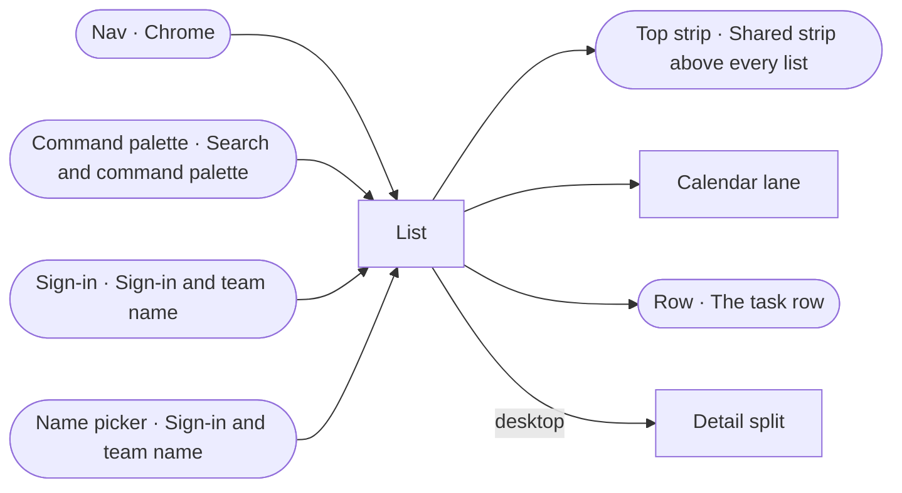

### `today.list` List

- **Root:** `data-surface`
- **Holds:** the [top strip](#shared-strip-above-every-list), then the calendar lane and four horizons. Kind of task and whose tasks are rows of the strip's Filters & sort sheet.
- **Does:** the horizons are **Due** (overdue first, then today; no heading, the header names it), **Soon** (tomorrow to a week out), **Later** and **No date** (each shows only when it holds something). Soon, Later and No date sit under the Board's group header (name and count, no rule, no chevron) and are always open: nothing folds. Inside a horizon rows run by due day, no project first, project A–Z, title.
- **States:** empty install shows *Add your first task* with an **Add a task** button; a filter with no match shows an empty line; counts sit on the group headers.
- **Desktop:** the list scrolls inside its own box under the strip at 1024px and up.
- **Leads to:**
  - [Top strip](#striptop-top-strip)
  - [Calendar lane](#todaycalendar-lane-calendar-lane)
  - [Row](#rowitem-row)
  - [Detail split](#todaydetail-split-detail-split) (desktop)

### `today.detail-split` Detail split

- **Root:** `data-surface`
- **Phone:** the drawer is a full-screen sheet.
- **Desktop:** (1024px and up): the right half is the [drawer](#task-drawer), never empty while a task is due: arriving on Today shows the first due task without writing a `#task/` link. With nothing due, or after closing, it reads *Select a task to see its details*. Leaving Today closes it.

### `today.calendar-lane` Calendar lane

- **Root:** `data-surface`
- **Reach:** above the horizons when the calendar block and an ICS address are configured.
- **Holds:** an all-day band of chips, timed events with their span, an event count.
- **Does:** read-only; nothing is written back.
- **States:** a failing feed shows a notice titled by cause (*address refused*, *unreachable*, *did not answer in time*, *feed unreadable*) with the time it began failing and the last good copy kept; a feed that parses but has events it could not evaluate says how many (*N recurring event(s) could not be checked — open the calendar itself*). Settings → Calendar holds the status and a refresh.
- **Why:** your real calendar beside the task list, without any write path.

## Board

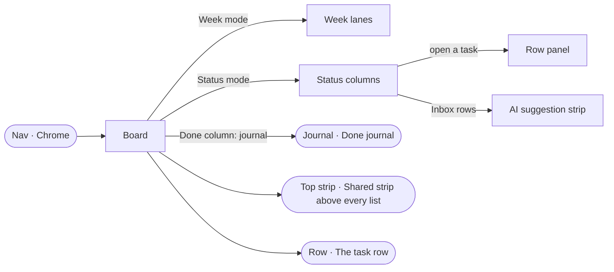

### `board.pane` Board

- **Root:** `data-surface`
- **Reach:** nav.
- **Holds:** the top strip, then the week lanes or the status columns. Two-dimensional, so it spans the window on desktop. The layout, the kind of task, whose tasks and Triage are rows of the strip's Filters & sort sheet.
- **Leads to:**
  - [Journal](#journalpane-journal) (Done column: journal)
  - [Top strip](#striptop-top-strip)
  - [Row](#rowitem-row)
  - [Week lanes](#boardweek-lanes-week-lanes) (Week mode)
  - [Status columns](#boardstatus-columns-status-columns) (Status mode)

### `board.week-lanes` Week lanes

- **Root:** `data-surface`
- **Holds:** **Today** (overdue included) · **Tomorrow** · **This week** · **This weekend** · **Next week** · **Later** (no-date tasks close it under a *No date* sub-heading).
- **Does:** drag a row onto a lane to re-date it to that lane's first day (toast and Undo, nothing but the due date changes).
- **Phone:** one list of lane sections, rows swipe, no drag.
- **Desktop:** lanes side by side, each scrolling under a sticky header with its count; an empty lane collapses to its header and stays a drop target.
- **Why:** every date belongs to exactly one lane, so *This week* and *This weekend* show only while they have days left after tomorrow.

### `board.status-columns` Status columns

- **Root:** `data-surface`
- **Holds:** **Inbox · Todo · Standby · Done today**; drag a row to change its status; ticking statuses in the filter sheet hides the other columns. The Done column head carries a **journal** link ([journal](#done-journal)).
- **Phone:** a one-column scroll-snap carousel whose count strip (*Inbox 4 · Todo 30 …*) is also the column switcher; no row swipe here because the columns already swipe sideways.
- **Leads to:**
  - [Row panel](#boardrow-panel-row-panel) (open a task)
  - [AI suggestion strip](#boardai-suggestion-ai-suggestion-strip) (Inbox rows)

### `board.ai-suggestion` AI suggestion strip

- **Root:** none — a line the row builder adds under an Inbox row.
- **Reach:** under an Inbox row after Triage staged a suggestion.
- **Holds:** a one-line summary (parent · priority · due · person) with its reason on hover and **Accept** and **Reject** icon buttons.
- **Why:** nothing is applied until accepted.

### `board.row-panel` Row panel

- **Root:** none — the task drawer ([`drawer.panel`](#task-drawer)) placed beside the lanes.
- **Phone:** full-screen sheet.
- **Desktop:** opening a card shows the drawer as a 440px side panel beside the lanes.

## Shared strip above every list

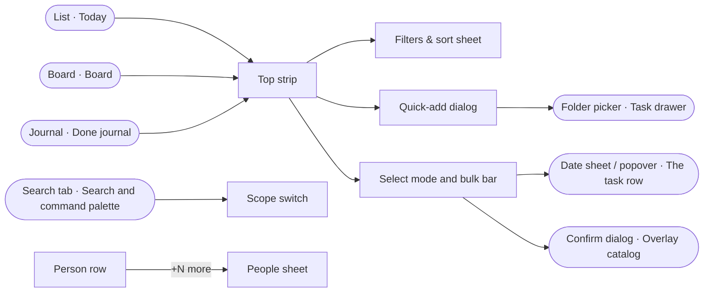

### `strip.top` Top strip

- **Root:** none — one strip sits in each of Today, Board and the journal, so no single element carries it.
- **Holds:** on one line, and nothing under it: the live **text filter** (placeholder carries the count, *Filter 12 tasks…*; on Today and Board the status filter sits inside it as removable **status pills**, a *Todo* pill by default, each a chip with a × that widens the search), the **filter button** (carries how many filters are on; its name spells them), **+**, and on a wide screen **Select** (on a phone Select is a row of the filter sheet, and the strip shows it only while Select mode is on, as **Done**). Today, Board and the Done journal carry it; Search carries its own box and the filter button inside it.
- **Leads to:**
  - [Filters & sort sheet](#stripfilter-sheet-filters--sort-sheet)
  - [Quick-add dialog](#stripquick-add-quick-add-dialog)
  - [Select mode and bulk bar](#stripbulk-bar-select-mode-and-bulk-bar)

### `strip.filter-sheet` Filters & sort sheet

- **Root:** `data-surface`
- **Reach:** filter button.
- **Holds:** **sort** (Due · Priority · Modified · Created · Title); on Today and Board the view toggles under it: **Select tasks** (enters Select mode and closes the sheet), **Layout** (Week · Status, Board only), **AI triage** (Board, Status layout, while the Inbox holds tasks; pressing it closes the sheet), **Kind of task** and **Whose tasks**; then **status** ticks (including `done` and `cancelled`), **project**, **person** ticks, **due window**, **modified window** (including *untouched over 30/60/90 days*, the stale pass), **Clear** (only while something is on), **Done**. On Search the status ticks are drawn with the open statuses ticked, and un-ticking them all means every status; on Today and Board the status ticks are drawn with Todo ticked and are the strip's status pills (one state): none ticked means every status for a typed query, named at the end of the header line.
- **Does:** applies live; the state is the URL. The filter button's count adds the kind of task and whose tasks when they are off their default, and Clear resets them. The layout hides nothing, so it is neither counted nor cleared. On Search and the journal the sheet has no view toggles and Clear leaves the scope and person row alone.
- **Phone:** a full-screen sheet with ticks two to a line. In the journal, status, due, modified and sort are hidden.

### `strip.scope` Scope switch

- **Root:** `data-surface`
- **Reach:** the **Kind of task** row of the Today and Board Filters & sort sheet; under the box on Search.
- **Holds:** **Tasks · Issues · All** (`?scope=`). Tasks (default) leaves out issues the forge sync brings in.

### `strip.person-row` Person row

- **Root:** `data-surface`
- **Reach:** two or more members; the **Whose tasks** row of the Today and Board Filters & sort sheet.
- **Holds:** **Mine** · each member · **Everyone**; with more than three other members the row keeps the picked and recent ones and folds the rest into **+N more**.
- **Does:** one tap picks one person; **+N more** opens **strip.people-sheet**. Mine and Everyone are per device (`?whose=everyone`); picked members ride `?owner=`. Search ignores the row and always covers everyone.
- **Why:** each phone signs in as its own member, so Mine needs no picker step.
- **Leads to:** [People sheet](#strippeople-sheet-people-sheet) (+N more)

### `strip.people-sheet` People sheet

- **Root:** `data-surface`
- **Reach:** **+N more**.
- **Holds:** a name filter, one tick per member, **Done**. The only place several people are picked at once; an emptied set falls back to Mine.

### `strip.bulk-bar` Select mode and bulk bar

- **Root:** `data-surface`
- **Reach:** **Select tasks** in the Filters & sort sheet; on a wide screen **Select** on the strip.
- **Does:** every row becomes a tick target (drag and phone swipe off; one selection shared across Today and Board). With one or more ticked the bar replaces the strip: *N selected* · **Move** (date sheet, [date sheet](#the-task-row)) · **Set status…** (native select: inbox, todo, standby, complete, done, cancelled) · **Set owner…** (two or more members) · **Delete** (confirm names the count, projects whose children go too, and synced issue tasks the next sync would bring back) · **Leave select mode**. Escape leaves. On a phone, before anything is ticked, the strip's **Done** leaves.
- **States:** a task that fails in a bulk write is named in the toast.
- **Leads to:**
  - [Date sheet / popover](#rowdate-date-sheet--popover)
  - [Confirm dialog](#confirmdialog-confirm-dialog)

### `strip.quick-add` Quick-add dialog

- **Root:** `data-surface`
- **Reach:** **+** · palette *New task* · no-tasks button.
- **Holds:** the title line (natural language, parsed on the server: trailing date, `starts`, `#id` or `› parent`), a **Dictate** mic, then **Project** (a select of the open projects, opening on the project the list is filtered to) and **Owner** (the members, opening on the viewer; absent for one member), description, due, starts, status, folder (typed, **Find in folder index**, or on the PC itself **From Explorer window**), one link (URL and label). The parsed parent shows as a chip and wins over the picked project, a parent that matches nothing as a red chip and nothing is created.
- **Does:** **Add** or Enter creates and focuses the row; Escape, the backdrop and × discard.
- **States:** dictation shows listening, settling and unreachable-service states. See [Views](views.md#views).
- **Leads to:** [Folder picker](#folderpicker-folder-picker)

## The task row

One row in Today, Board, Search task hits and the journal.

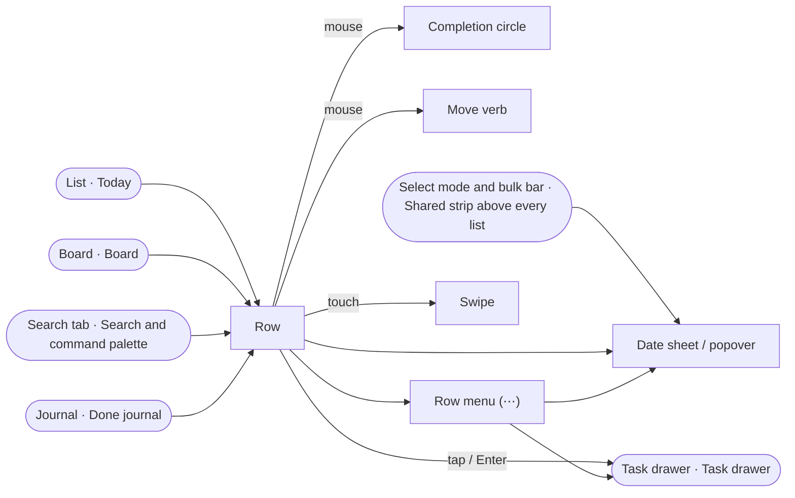

### `row.item` Row

- **Root:** `data-surface`
- **Holds:** leading **project pill** (Today and Board) · one-line title · one meta line (context name, then due, exception chips, counts). Tapping anywhere opens the drawer.
- **Why:** nothing on the meta line is a target; 60px a row.
- **Leads to:**
  - [Row menu (⋯)](#rowmenu-row-menu-)
  - [Date sheet / popover](#rowdate-date-sheet--popover)
  - [Task drawer](#drawerpanel-task-drawer) (tap / Enter)
  - [Completion circle](#rowcomplete-completion-circle) (mouse)
  - [Move verb](#rowmove-move-verb) (mouse)
  - [Swipe](#rowswipe-swipe) (touch)

### `row.complete` Completion circle

- **Root:** none — a control on the row. *Mouse only.* Completes an open task (a recurring one rolls) or reopens a closed one, with Undo.

### `row.move` Move verb

- **Root:** none — a control on the row. *Mouse only, open rows outside Board lanes.* A calendar glyph button; opens the date popover.
- **Why:** re-dating is most of what is done to a task.

### `row.menu` Row menu (⋯)

- **Root:** `data-surface`
- **Reach:** kebab · right-click · `.` · the menu key on a focused row.
- **Holds:** the actions in the order set in Settings → Row actions: Complete or Reopen, **Move…**, Status (inbox, standby, cancelled, todo as it applies), **Cycle priority**, Due tomorrow, Due next week; then, when the task has them, **Open folder**, **Open AI conversation** (and **Resume in CLI** for a resumable session), **Open issue `repo#N`**; last **Open details**.
- **Why:** one table of actions (`actions.js`) feeds the menu, the keys, the palette and the swipes.
- **Leads to:**
  - [Date sheet / popover](#rowdate-date-sheet--popover)
  - [Task drawer](#drawerpanel-task-drawer)

### `row.date` Date sheet / popover

- **Root:** `data-surface`
- **Reach:** the Move verb, a swipe left, the menu's Move…, `d`, Select mode's Move. The drawer's Due block is the same chip grid.
- **Holds:** one 4 × 2 grid of 44px chips, **Today · Tomorrow · This Fri · Weekend · Next week · Next Mon · Month end**, each over the date it lands on (the task's own day tinted), and **Pick…** (a native date field) as the eighth; **No date** as a row under the grid.
- **Phone:** a bottom sheet (a dialog). One pick moves the task and leaves it on the list, with Undo.
- **Desktop:** a popover next to the row.

### `row.swipe` Swipe

- **Root:** none — a gesture, with no element of its own. *Touch only, open rows in a vertical list.* Right completes, left opens the date sheet by default; both are configurable.
- **Holds:** Starts away from the screen edge, locks sideways, commits past 96px or a quick flick, never in the phone Board's Status carousel. Revealed label turns to *Release to …* when armed.

## Task drawer

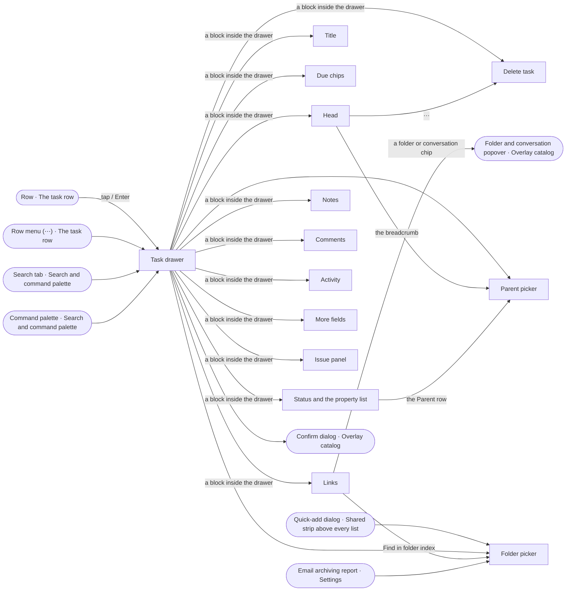

### `drawer.panel` Task drawer

- **Root:** `data-surface`
- **Reach:** a row tap or Enter · menu *Open details* · `#task/<id>` · Today's auto-opened first task.
- **Holds:** the blocks below, in the order of the usual flow on a task: head, title, status, due chips, comments, the property list, notes, more fields, activity. With a task open the row keys act on it (see the keyboard map).
- **Phone:** full-screen, one column, the comment field pinned to the foot. Escape or **Close** closes it (then leaves Select mode).
- **Desktop:** side panel or split pane; one column, and from 720px of drawer width the content beside the property list. Each control shows its key, and a line under the property list lists them.
- **Why:** the common edits take the fewest taps: status and the due moves are one tap, Owner, Person, Repeat and Priority two, a comment is always one tap away; Send is the only primary button.
- **Leads to:**
  - [Parent picker](#drawerparent-picker-parent-picker)
  - [Folder picker](#folderpicker-folder-picker)
  - [Confirm dialog](#confirmdialog-confirm-dialog)
  - [Status and the property list](#drawerfields-status-and-the-property-list) (a block inside the drawer)
  - [Notes](#drawerdescription-notes) (a block inside the drawer)
  - [Title](#drawertitle-title) (a block inside the drawer)
  - [Links](#drawerlinks-links) (a block inside the drawer)
  - [Activity](#draweractivity-activity) (a block inside the drawer)
  - [Head](#drawerhead-head) (a block inside the drawer)
  - [More fields](#drawermore-more-fields) (a block inside the drawer)
  - [Due chips](#drawerdue-due-chips) (a block inside the drawer)
  - [Issue panel](#drawerissue-issue-panel) (a block inside the drawer)
  - [Delete task](#drawerdelete-delete-task) (a block inside the drawer)
  - [Comments](#drawercomments-comments) (a block inside the drawer)

### `drawer.head` Head

- **Root:** none — a block inside the drawer panel.
- **Holds:** the breadcrumb as one button (opens the [parent picker](#task-drawer)), an *Inbox* tag on a task still in Inbox, **···** (*Open <parent>*; **Delete task** last after a divider; its header is the task's code) and **Close**.
- **Leads to:**
  - [Parent picker](#drawerparent-picker-parent-picker) (the breadcrumb)
  - [Delete task](#drawerdelete-delete-task) (···)

### `drawer.title` Title

- **Root:** none — a block inside the drawer panel.
- **Holds:** an editable field in heading-md with a visible underline; Enter saves, Escape reverts.

### `drawer.due` Due chips

- **Root:** none — a block inside the drawer panel.
- **Holds:** the date sheet's chip grid — *Today · Tomorrow · This Fri · Weekend · Next week · Next Mon · Month end · Pick…* — each over its date, the task's own day tinted. One tap moves the due date; `t`, `w` and `d` reach the same moves.

### `drawer.fields` Status and the property list

- **Root:** none — a block inside the drawer panel.
- **Holds:** **Status** as a segmented control (*To do · Standby · Cancelled · Done*; an Inbox task raises none). **Done closes the drawer** with an Undo toast; a recurring task's Done rolls it. Then one inset group of 44px rows: **Links** (see below), **Due** typed in place (× clears it), **Owner** (only with two or more members; an `owner old → new` activity row names who), **Person**, **Parent** (the parent picker), **Repeat** (with *Every N* and the fixed day once there is a cadence) and, last and smaller, **Priority**. Owner, Person, Repeat and Priority each open a row menu of their values.
- **Leads to:** [Parent picker](#drawerparent-picker-parent-picker) (the Parent row)

### `drawer.links` Links

- **Root:** none — a row of the drawer's property list.
- **Holds:** pills for the folder, the issue and every link no comment already shows (a stored link whose URL sits in a comment is left out here, since the thread shows it; nothing stored changes, and the link editor below still lists them all), each opening on one click; an AI-conversation URL wears the bot chip; a folder chip is a `taskos://` link opened by the per-PC opener (the phone shows the path to copy). **+** (or `l`) unfolds the **Folder** editor (typed ref, **Find in folder index**, or on the PC itself **From Explorer window**) and the link editor (label edit, remove, **Add link**) under the group.
- **Leads to:**
  - [Folder and conversation popover](#chipfolder-popover-folder-and-conversation-popover) (a folder or conversation chip)
  - [Folder picker](#folderpicker-folder-picker) (Find in folder index)

### `drawer.description` Notes

- **Root:** none — a block inside the drawer panel.
- **Holds:** the task's markdown description. A tap on the text edits it in place; leaving the field saves, Escape cancels.

### `drawer.comments` Comments

- **Root:** none — a block inside the drawer panel.
- **Holds:** newest first, the latest three then *Show N older*. The comment field and **Send** (the drawer's one primary button, Ctrl+Enter) head the list on a desktop (`c` focuses it) and are pinned to the sheet's foot on the phone. One compact row per comment: a time column (time today, *Yest.*, a short date), the text clamped to two lines (tap the row to open the rest), the author after the text only when it is somebody else, and one **···** menu with **Edit** (in place, Ctrl+Enter saves, Escape cancels) and **Delete** (asks first, no undo). A comment with exactly one web link is that link: its text opens the URL in a new window (the raw URL is not shown); a URL-only comment, several targets, a folder, an issue ref or an AI conversation keep chips.

### `drawer.activity` Activity

- **Root:** none — a block inside the drawer panel.
- **Holds:** a disclosure closed by default, its count in the summary (*6 changes*), open or closed for the page's life: `field old → new · actor · time`; issue-sync rows fold behind *Show N sync updates*.

### `drawer.parent-picker` Parent picker

- **Root:** `data-surface`
- **Holds:** a centred card on desktop, full screen on the phone: a filter field (*Filter N open tasks*), then **Recent** (the parents this device used last) and **No parent (top level)**, hidden while a filter is typed, then every open task in tree order, indented, each with its path; the task itself, its descendants and closed tasks are not offered. Tap or Enter on the first match files it; No parent moves it to the top level (no confirm, no Undo); a cycle is refused with a toast. Reached from the breadcrumb or the Parent row; the one way to re-parent.

### `drawer.more` More fields

- **Root:** none — a block inside the drawer panel.
- **Holds:** a disclosure closed by default whose summary names what is set (*starts in 3d · CODE-1 · 1 blocker*); once opened it stays open for the page's life. Inside: **Starts** (a date; the only place the start date is edited), **Code**, **Blocked by** (**Add blocker**), **Children** (click to navigate, **Add child**), and the **Issue panel**.

### `drawer.issue` Issue panel

- **Root:** none — a block inside the drawer panel.
- **Holds:** a linked issue shows its provider glyph, `repo#N`, state, labels, last-synced time, **Sync now** and **Unlink**; a plain task shows **Create issue** (repo from the last-seen list or typed) and **Link existing** (`owner/repo#N` or URL). Gone when Issue sync is off. See [Issues as tasks](issues-as-tasks.md#issues-as-tasks).

### `drawer.delete` Delete task

- **Root:** none — it opens [`confirm.dialog`](#overlay-catalog).
- **Holds:** the last item of the head's **···**, after a divider. A confirm names the task and its subtree, says there is no trash and no undo, and for a synced task with an open issue warns the next sync recreates it. A toast says how much went.

### `folder.picker` Folder picker

- **Root:** `data-surface`
- **Holds:** a search-as-you-type list over the folder index with **Find in folder index** as its opener; Enter attaches the first hit, Escape closes the picker first. Shared by the drawer, the quick-add dialog and Email archiving's file-it panel.
- **States:**
  - the index not configured or unavailable says so instead of listing nothing.
  - the drawer's Folder field and the quick-add dialog's also carry **From Explorer window**, a folder glyph beside the opener, on the PC itself only; it fills the field (the drawer also shows the path in full in a note under the line), saves nothing until **Set folder** or **Add**, and says which when it cannot (no folder window open, Windows could not say, folder-explorer down or too old).

## Time

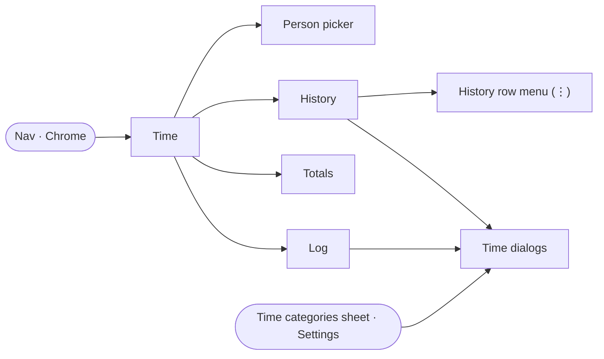

### `time.pane` Time

- **Root:** `data-surface`
- **Reach:** nav.
- **Holds:** the **Log · Totals · History** segment under the header and the view it picks.
- **States:** hidden when its block is off. One-dimensional (772px measure). See [Time tracking](time-tracking.md#time-tracking).
- **Leads to:**
  - [Log](#timelog-log)
  - [Totals](#timetotals-totals)
  - [History](#timehistory-history)
  - [Person picker](#timeperson-picker-person-picker)

### `time.log` Log

- **Root:** `data-surface`
- **Holds:** *Today so far* (per person, with each person's running state), **Start a timer** (Recent first, then each area with its categories as large tiles, each with its subtitle), **Add time already spent**.
- **Does:** tapping a tile starts a timer; with one running, a **Stop and start …** choice replaces the timer in one call. A running timer's tile reads *Running now* and the card shows **Stop and save** and **Discard** (immediate, with a *Timer discarded* toast and no undo). Past the long-timer limit the card asks whether the timer was forgotten and lets you correct the minutes. A running timer is the server's: a reload or another device shows the same one.
- **Leads to:** [Time dialogs](#timedialog-time-dialogs)

### `time.totals` Totals

- **Root:** `data-surface`
- **Holds:** **Today · 7 days · 30 days · All**, an **Area** filter, **Me · Everyone** when there are several people, a total, per-category bars, and on the compare area with two or more people the head-to-head, the split bar, days logged per person, a **How the comparison works** info dialog and **Guess your share** (**Lock in**; the other guess stays hidden until yours is locked), **Download CSV**. People differ by initials and fill, never by colour.

### `time.history` History

- **Root:** `data-surface`
- **Holds:** every entry by day with its clock range or, for an imported entry, its duration; each row's **More actions** holds **Edit**, **Start again** and **Delete** (confirmed).
- **Leads to:**
  - [Time dialogs](#timedialog-time-dialogs)
  - [History row menu (⋮)](#timehistory-menu-history-row-menu-)

### `time.history-menu` History row menu (⋮)

- **Root:** `data-surface`
- **Reach:** a history row's **More actions**.
- **Holds:** **Edit**, **Start again**, **Delete** (confirmed).

### `time.dialog` Time dialogs

- **Root:** `data-surface`
- **Holds:** **Add time already spent / Edit entry** (person, category, day with Today and Yesterday, start, minutes with 15/30/45/60/90/120 chips, note), **A timer is running** (the switch choice), text prompts and option pickers for categories, and a plain info dialog. Closed by × or Escape.

### `time.person-picker` Person picker

- **Root:** `data-surface`
- **Holds:** on first visit when a team sign-in names nobody in the install, a one-time question of who is logging, kept in memory only.

## Search and command palette

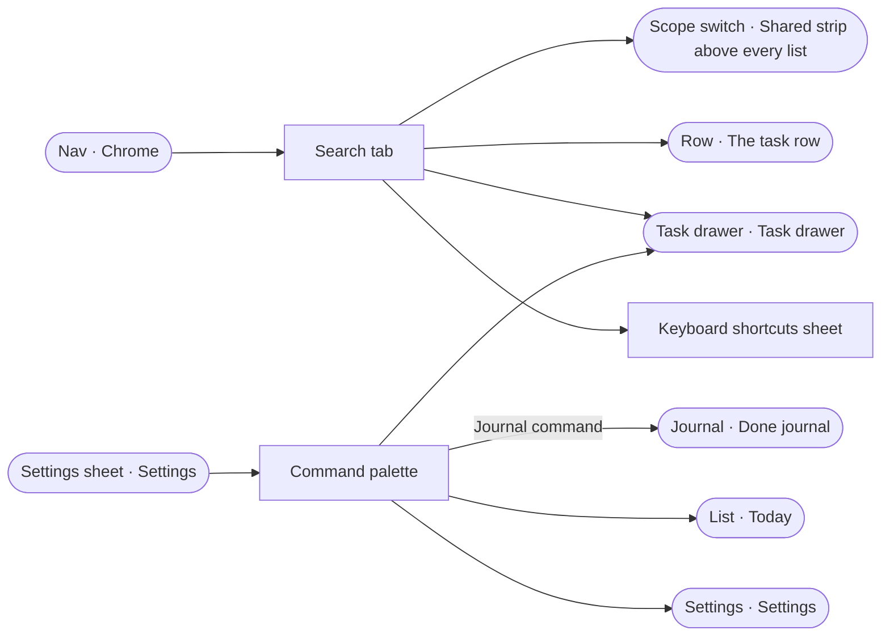

### `search.pane` Search tab

- **Root:** `data-surface`
- **Reach:** nav · `#search` · Go to Search.
- **Holds:** an auto-focused box (a **Clear search** button that shows only while the box holds text, a filter button, and the scope switch under it), a count, and results. *Clear search* is a 44px target; one tap empties the query, the count and the results, and keeps focus in the box (Escape in the box does the same). A group appears only for a kind with hits (Tasks, Folders, Emails, Issues), open, under an uppercase header with its count; every other kind folds into one line (*No matches in …*, *Not set up: …*). Task hits are the standard row plus the matched snippet, exact first, then *Partial matches*, then *Similar matches*; other hits are a title and one meta line whose single control opens them. The count line ends with the statuses the task hits cover (*open only*, *every status*, or the ticked ones), and the *No matches* line names them after Tasks.
- **States:** folder-explorer answering badly is its own line per kind, never *No matches*: *unreachable*, *indexing*, *not set up*, *failed*, with the reason; a broken index is shown in the danger tone. *Keys:* Down from the box focuses the first row, Up and Down move, Enter opens, Escape or `/` returns to the box.
- **Why:** the 200ms debounce and the *`?q=`* URL make a search shareable.
- **Leads to:**
  - [Scope switch](#stripscope-scope-switch)
  - [Row](#rowitem-row)
  - [Task drawer](#drawerpanel-task-drawer)
  - [Keyboard shortcuts sheet](#keyshelp-keyboard-shortcuts-sheet)

### `search.palette` Command palette

- **Root:** `data-surface`
- **Reach:** Ctrl+K or Cmd+K from any tab · Settings → Command palette → **Open command palette** (the phone's only way; the header has no button).
- **Holds:** a box; plain text jumps to a task (top eight: title, breadcrumb, status); `>` lists commands. Commands: *New task* · the row actions for the focused or ticked task (first while one is targeted) · *Go to Today / Board / Time / Archive / Search / Settings* · *Journal* · *Filter: status inbox / todo / standby / done / cancelled* · *Filter: clear* · *Sync issues* · *Export mirror* · *Open folder of current task* · *Toggle theme* · *Sign out*. Commands of a switched-off block are omitted. Up/Down move, Enter runs, Escape closes.
- **Phone:** a full-width sheet.
- **Leads to:**
  - [Journal](#journalpane-journal) (Journal command)
  - [Task drawer](#drawerpanel-task-drawer)
  - [List](#todaylist-list)
  - [Settings](#settingspane-settings)

### `keys.help` Keyboard shortcuts sheet

- **Root:** `data-surface`
- **Reach:** `?`. A list of every key (below), including the ones the palette shows with their key.

## Done journal

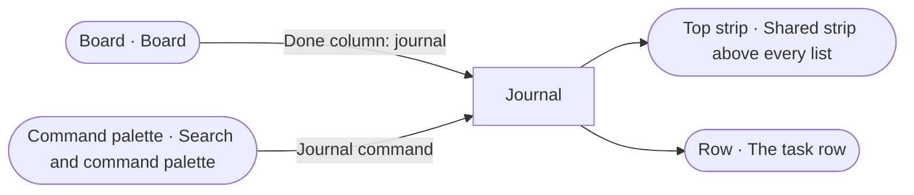

### `journal.pane` Journal

- **Root:** `data-surface`
- **Reach:** the Board's Done column head (**journal**) · palette *Journal* · `#journal`, `#journal/task/<id>`.
- **Holds:** the shared text strip and filter sheet (project, person, text), a **Show cancelled** toggle, closed tasks newest day first under one heading per local day (*Yesterday · Tue 1 Sep · 2 done*), cancelled ones muted, **Show the week before** to widen by seven days.
- **Does:** the filled circle reopens a task in place; the row opens the drawer.
- **States:** it says it has reached the end only once the server confirms nothing closed earlier; an install with nothing closed says so. Any tab press leaves.
- **Why:** a reading surface (the answer to "what happened this week"), not a tab.
- **Leads to:**
  - [Top strip](#striptop-top-strip)
  - [Row](#rowitem-row)

## Settings

| Group | Row | Value shown | Sheet holds |
| --- | --- | --- | --- |
| This device | **Text size** | Small / Default / Large (in place, no sheet) | a three-way control; scales rem-based type, not rows or icons |
| | **Full screen on Edge** | an on / off switch (in place, no sheet), shown in Edge only | hides the address bar and toolbar; while on and out of full screen the hint adds *Tap anywhere to go full screen.* |
| | **Row actions** | *Default* | a select for **swipe right** and one for **swipe left** (any action or nothing), then every row action with **Show in the menu**, **Move up**, **Move down**, and **Reset to the defaults**; an action a swipe runs always stays in the menu |
| | **Command palette** | *Ctrl+K* | a line of explanation and **Open command palette** |
| | **Phone access** | the client (*this PC* or the member) | who you are signed in as, whether HTTPS is on, whether a token and a password are set (and the script that sets them), the team line *you are X · change name* with team mode, install hints for iOS and Android, **Sign out on this device** (only for a cookie session) |
| Sync | **Issues as tasks** | on / off / failing | provider, repos, next and last pass and result, **Sync now** |
| | **Calendar** | on / error / unknown | the feed host only (never the address), refresh cadence, last fetch, failure cause, **Refresh now** |
| Email | **Capture into Inbox** | on / off | the last flagged-mail pass and its state, **Check now** |
| | **Email archiving** | off / ready / running / *N need you* | **Archive Inbox now**, a first-N bound, the archiver state, the run picker, **Accept all (N)**, the run report (below) |
| Tools | **Time categories** | *4 areas · 13 categories* | areas and their categories; **Add area**; per area **Rename · Add category · Move up/down · Archive**; per category **Edit · Move up/down · Move to another area · Archive** and **Delete** only while nothing points at it; dialogs carry the subtitle field |
| | **Search** | indexed / not set up | the four indexes with their state and reason |
| | **Folder opener** | on / not installed | the install command with **Copy command**, whether the opener is installed on this PC, and a disclosure *Uninstall · folder paths for each PC* with **Copy** |
| | **Voice quick-add** | on / off | the transcription chain, its state and reason |
| | **AI Inbox triage** | on / off | the local-AI state and reason, what triage sends and that suggestions stay staged |
| Available features | one switch per block (Time tracker · Calendar lane · Issue sync · Email and folders · Local AI · Mirror and backups · Publish host address, off until opted in) | on / off, or *on, unavailable here: reason*; the opt-in row reads its last outcome (*Published* · *Unchanged* · *Unavailable* · *Failed*, with the reason) | a switch that applies at once, no reload; a block whose dependency is missing says why; turning the opt-in row on publishes once |
| This install | **Your name** | the saved name or *not set* | a field and **Save name**; blank clears it, the line under it shows the name an unsigned write uses |
| | **Database** | schema version | where config and data live, the schema version |
| | **Mirror and backup** | off / on | what is exported and backed up, import conflicts with **Clear import conflicts** |

Each sheet is one entry named by the row that opens it; what it holds is the table's *Sheet holds* column.

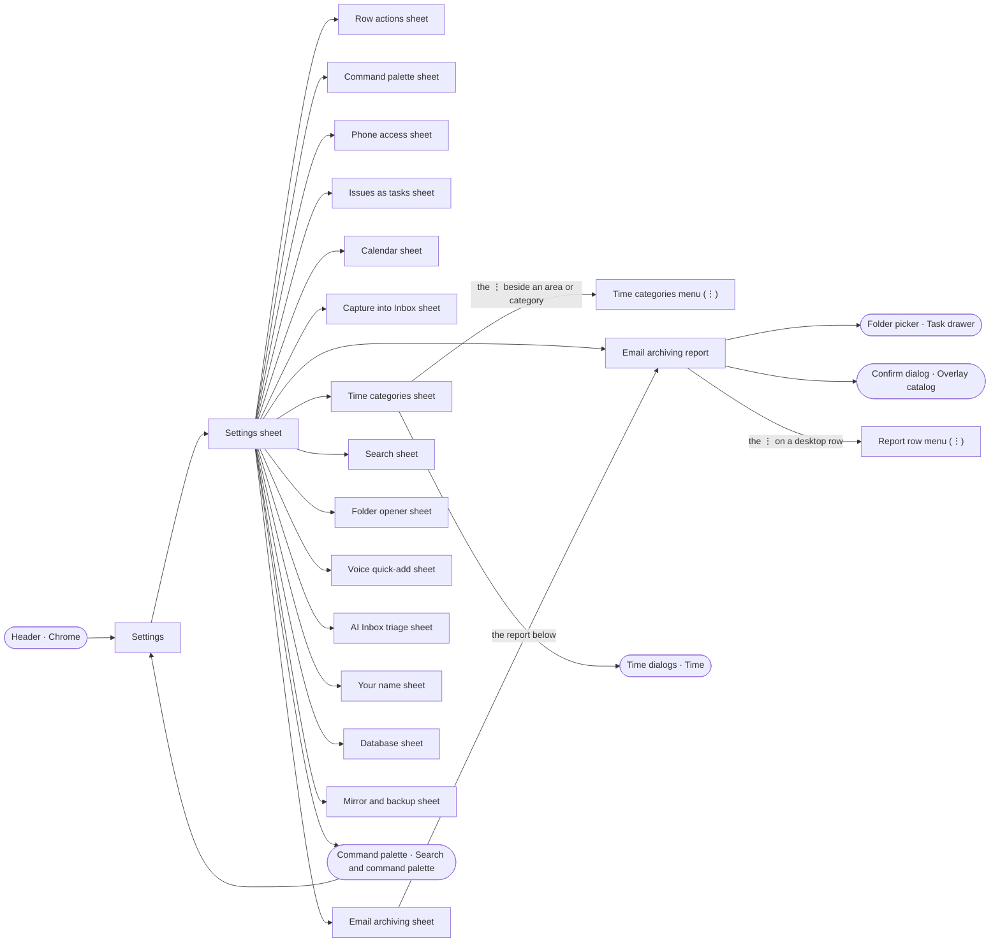

### `settings.pane` Settings

- **Root:** `data-surface`
- **Reach:** the header gear · palette *Go to Settings* · `#settings`. The fleet's full Settings page (vendored settings-group): a modal dialog over the current tab, full screen on a phone and a centred 772px column on desktop, its title and **×** in a sticky header; **×** or Escape returns to the tab, which stays as it was under it. Under the header a line names what needs attention (*3 mails need you*, *Issue sync failing*, else *6 of 9 services on*), then six inset groups with sentence-case labels; each row shows its lead glyph, label, its current value (in the attention or danger tone when it is an exception) and a chevron. A row opens its **sheet**, a modal over the page on every width (the Email archiving report's sheet spans the window). `#settings/<row>` keeps a sheet across reload; Back closes it.
- **Leads to:** [Settings sheet](#settingssheet-settings-sheet)

### `settings.sheet` Settings sheet

- **Root:** `data-surface`
- **Reach:** any Settings row that opens something · `#settings/<row>`.
- **Holds:** a title, **×**, and the one sheet its row names (below).
- **Does:** **Done**, **×**, Escape and Back close it.
- **Phone:** a modal sheet that fits the screen, **Done** pinned at the bottom whatever the sheet's length.
- **Desktop:** a centred modal sheet over the Settings page; Email archiving's spans the window.
- **Leads to:**
  - [Email archiving report](#archivereport-email-archiving-report)
  - [Time categories sheet](#settingstime-categories-time-categories-sheet)
  - [Command palette](#searchpalette-command-palette)
  - [Row actions sheet](#settingsrow-actions-row-actions-sheet)
  - [Your name sheet](#settingsyour-name-your-name-sheet)
  - [Folder opener sheet](#settingsopener-folder-opener-sheet)
  - [Calendar sheet](#settingscalendar-calendar-sheet)
  - [Command palette sheet](#settingspalette-command-palette-sheet)
  - [Phone access sheet](#settingsaccess-phone-access-sheet)
  - [AI Inbox triage sheet](#settingsai-triage-ai-inbox-triage-sheet)
  - [Database sheet](#settingsdatabase-database-sheet)
  - [Voice quick-add sheet](#settingsvoice-voice-quick-add-sheet)
  - [Issues as tasks sheet](#settingsissues-issues-as-tasks-sheet)
  - [Search sheet](#settingssearch-search-sheet)
  - [Mirror and backup sheet](#settingsmirror-mirror-and-backup-sheet)
  - [Email archiving sheet](#settingsarchive-email-archiving-sheet)
  - [Capture into Inbox sheet](#settingscapture-capture-into-inbox-sheet)

### `settings.row-actions` Row actions sheet

- **Root:** `data-surface`
- **Reach:** Settings → Row actions · `#settings/rows`.

### `settings.palette` Command palette sheet

- **Root:** `data-surface`
- **Reach:** Settings → Command palette · `#settings/palette`.

### `settings.access` Phone access sheet

- **Root:** `data-surface`
- **Reach:** Settings → Phone access · `#settings/access`.

### `settings.issues` Issues as tasks sheet

- **Root:** `data-surface`
- **Reach:** Settings → Issues as tasks · `#settings/issues`.
- **States:** gone when Issue sync is off.

### `settings.calendar` Calendar sheet

- **Root:** `data-surface`
- **Reach:** Settings → Calendar · `#settings/calendar`.
- **States:** gone when the Calendar lane is off.

### `settings.capture` Capture into Inbox sheet

- **Root:** `data-surface`
- **Reach:** Settings → Capture into Inbox · `#settings/capture`.
- **States:** gone when Email and folders is off.

### `settings.archive` Email archiving sheet

- **Root:** `data-surface`
- **Reach:** Settings → Email archiving · `#settings/archive`.
- **Holds:** the run controls and the report below.
- **Desktop:** spans the window.
- **Leads to:** [Email archiving report](#archivereport-email-archiving-report) (the report below)

### `settings.time-categories` Time categories sheet

- **Root:** `data-surface`
- **Reach:** Settings → Time categories · `#settings/timecats`.
- **States:** gone when Time is off.
- **Leads to:**
  - [Time dialogs](#timedialog-time-dialogs)
  - [Time categories menu (⋮)](#settingstime-menu-time-categories-menu-) (the ⋮ beside an area or category)

### `settings.search` Search sheet

- **Root:** `data-surface`
- **Reach:** Settings → Search · `#settings/search`.

### `settings.opener` Folder opener sheet

- **Root:** `data-surface`
- **Reach:** Settings → Folder opener · `#settings/opener`.

### `settings.voice` Voice quick-add sheet

- **Root:** `data-surface`
- **Reach:** Settings → Voice quick-add · `#settings/voice`.
- **States:** gone when Local AI is off.

### `settings.ai-triage` AI Inbox triage sheet

- **Root:** `data-surface`
- **Reach:** Settings → AI Inbox triage · `#settings/ai`.
- **States:** gone when Local AI is off.

### `settings.your-name` Your name sheet

- **Root:** `data-surface`
- **Reach:** Settings → Your name · `#settings/yourname`.

### `settings.database` Database sheet

- **Root:** `data-surface`
- **Reach:** Settings → Database · `#settings/install`.

### `settings.mirror` Mirror and backup sheet

- **Root:** `data-surface`
- **Reach:** Settings → Mirror and backup · `#settings/mirror`.
- **States:** gone when Mirror and backups is off.

### `settings.time-menu` Time categories menu (⋮)

- **Root:** `data-surface`
- **Reach:** the ⋮ beside an area or a category in the Time categories sheet.
- **Holds:** Rename or Edit, Move up, Move down, Move to another area, Archive, and Delete only while nothing points at it.

### `archive.report` Email archiving report

- **Root:** `data-surface`
- **Reach:** Settings → Email archiving · palette *Go to Archive*.
- **States:** *No run yet*, running (the run button reads *Archiving…* and is disabled), not configured with the reason, a run that failed with its reason. See [Archive the Inbox](inbox-archive.md#archive-the-inbox).
- **Phone:** cards, with the review levels behind **Review**. Each row's **⋮** offers exactly what its state allows: **Accept** (a mail that needed a human), **Move to… / File it…** (the ranked candidates or any folder through the folder picker, with an optional hint the next run remembers), **Retry** (the file was written before Outlook refused the move), **Revert** (files deleted, mail back to the Inbox; only a filed row). A run picker lists earlier runs and **Accept all (N)** clears a reviewed batch; anything touching files asks first.
- **Desktop:** a table (subject with who and when · destination as its last three components · files as chips, the first shown and *+N more* · confidence · why · state).
- **Leads to:**
  - [Folder picker](#folderpicker-folder-picker)
  - [Confirm dialog](#confirmdialog-confirm-dialog)
  - [Report row menu (⋮)](#archiverow-menu-report-row-menu-) (the ⋮ on a desktop row)

### `archive.row-menu` Report row menu (⋮)

- **Root:** `data-surface`
- **Reach:** the ⋮ on a desktop report row.
- **Holds:** exactly the actions the row's state allows (see the report above).

## Sign-in and team name

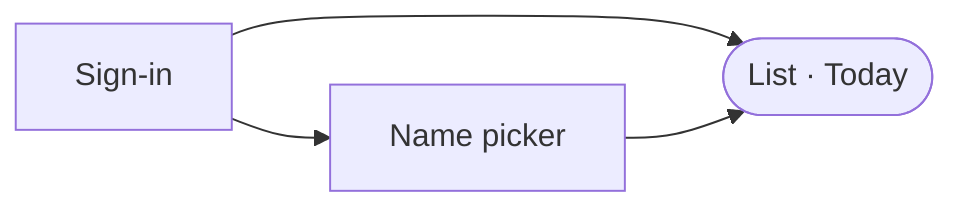

### `login.card` Sign-in

- **Root:** `data-surface`
- **Reach:** (`/login`, public)
- **Holds:** a card with one field (*Token or password*) and **Sign in**; a wrong secret says *wrong token or password*. A token or password sets a 90-day cookie. With team mode on, the team password signs in and leads to **login.name-picker**. Not reached on the install's own PC, which needs no credential.
- **Leads to:**
  - [Name picker](#loginname-picker-name-picker)
  - [List](#todaylist-list)

### `login.name-picker` Name picker

- **Root:** `data-surface`
- **Holds:** *Who are you?* with one button per member (initials and name, the first focused). It sets a label recorded on comments and changes, never a credential; *change name* in Settings → Phone access returns here.
- **Leads to:** [List](#todaylist-list)

## Overlay catalog

| Overlay | Kind | Opened by | Closed by |
| --- | --- | --- | --- |
| Filter sheet | modal sheet | filter button | **Done**, ×, Escape |
| People sheet | modal | **+N more** | **Done**, ×, Escape |
| Quick-add | modal | **+**, palette, empty-state button | **Add**, ×, Escape |
| Command palette | modal | Ctrl+K, Settings row | Escape, backdrop |
| Keyboard shortcuts | modal | `?` | Escape, × |
| Confirm | modal | every delete, bulk delete, archive file actions, time delete | **Cancel**, Escape |
| Parent picker | modal card | **Change parent** | Escape, backdrop |
| Time dialogs | modal | tiles, history menu, categories | ×, Escape |
| Date sheet | sheet on touch, popover on mouse | Move paths | pick, Escape, outside tap |
| Row menu | popover | kebab, right-click, `.` | Escape, outside tap, any pick |
| Settings page | full-window modal | the header gear, palette, `#settings` | ×, Escape |
| Settings sheet | modal sheet over the Settings page | a Settings row | **Done**, ×, Escape, Back |
| Task drawer | side panel, split or full-screen | a row | Close, Escape |
| Toast | transient | a write | timer, ×, Undo |

A modal hides the phone's floating nav while it is open.

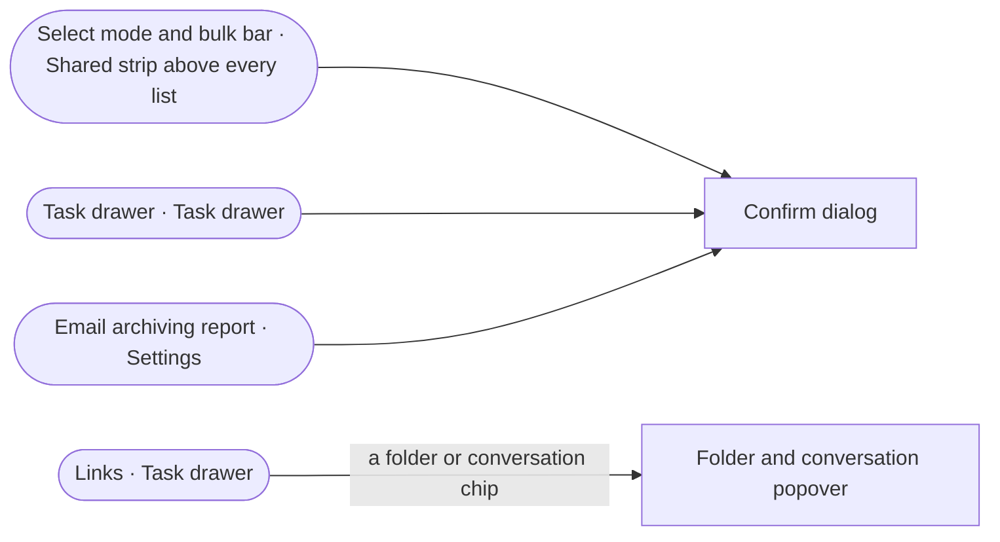

### `confirm.dialog` Confirm dialog

- **Root:** `data-surface`
- **Reach:** every delete (a task from the drawer, a selection from the bulk bar, a time entry), an archive file action.
- **Holds:** a title, a line naming what goes, **Cancel** and one danger-tinted action.
- **Does:** the action runs the write; **Cancel**, Escape and the backdrop mean no.
- **Why:** one destructive-action dialog, built per ask.

### `chip.folder-popover` Folder and conversation popover

- **Root:** `data-surface`
- **Reach:** a folder chip, or an AI-conversation chip, on a fine pointer; on a phone a folder with no web address shows the path to copy here.
- **Holds:** the resolved path with **Copy**, or **Open conversation** and, for a Claude Code session, **Resume in CLI on this PC**.
- **Does:** Escape or an outside click closes it without closing the drawer under it.

## Link index

| From | Via | To |
|---|---|---|
| [Header](#chromeheader-header) |  | [Settings](#settingspane-settings) |
| [Nav](#chromenav-nav) |  | [List](#todaylist-list) |
| [Nav](#chromenav-nav) |  | [Board](#boardpane-board) |
| [Nav](#chromenav-nav) |  | [Time](#timepane-time) |
| [Nav](#chromenav-nav) |  | [Search tab](#searchpane-search-tab) |
| [List](#todaylist-list) |  | [Top strip](#striptop-top-strip) |
| [List](#todaylist-list) |  | [Calendar lane](#todaycalendar-lane-calendar-lane) |
| [List](#todaylist-list) |  | [Row](#rowitem-row) |
| [List](#todaylist-list) | desktop | [Detail split](#todaydetail-split-detail-split) |
| [Board](#boardpane-board) | Done column: journal | [Journal](#journalpane-journal) |
| [Board](#boardpane-board) |  | [Top strip](#striptop-top-strip) |
| [Board](#boardpane-board) |  | [Row](#rowitem-row) |
| [Board](#boardpane-board) | Week mode | [Week lanes](#boardweek-lanes-week-lanes) |
| [Board](#boardpane-board) | Status mode | [Status columns](#boardstatus-columns-status-columns) |
| [Status columns](#boardstatus-columns-status-columns) | open a task | [Row panel](#boardrow-panel-row-panel) |
| [Status columns](#boardstatus-columns-status-columns) | Inbox rows | [AI suggestion strip](#boardai-suggestion-ai-suggestion-strip) |
| [Top strip](#striptop-top-strip) |  | [Filters & sort sheet](#stripfilter-sheet-filters--sort-sheet) |
| [Top strip](#striptop-top-strip) |  | [Quick-add dialog](#stripquick-add-quick-add-dialog) |
| [Top strip](#striptop-top-strip) |  | [Select mode and bulk bar](#stripbulk-bar-select-mode-and-bulk-bar) |
| [Person row](#stripperson-row-person-row) | +N more | [People sheet](#strippeople-sheet-people-sheet) |
| [Select mode and bulk bar](#stripbulk-bar-select-mode-and-bulk-bar) |  | [Date sheet / popover](#rowdate-date-sheet--popover) |
| [Select mode and bulk bar](#stripbulk-bar-select-mode-and-bulk-bar) |  | [Confirm dialog](#confirmdialog-confirm-dialog) |
| [Quick-add dialog](#stripquick-add-quick-add-dialog) |  | [Folder picker](#folderpicker-folder-picker) |
| [Row](#rowitem-row) |  | [Row menu (⋯)](#rowmenu-row-menu-) |
| [Row](#rowitem-row) |  | [Date sheet / popover](#rowdate-date-sheet--popover) |
| [Row](#rowitem-row) | tap / Enter | [Task drawer](#drawerpanel-task-drawer) |
| [Row](#rowitem-row) | mouse | [Completion circle](#rowcomplete-completion-circle) |
| [Row](#rowitem-row) | mouse | [Move verb](#rowmove-move-verb) |
| [Row](#rowitem-row) | touch | [Swipe](#rowswipe-swipe) |
| [Row menu (⋯)](#rowmenu-row-menu-) |  | [Date sheet / popover](#rowdate-date-sheet--popover) |
| [Row menu (⋯)](#rowmenu-row-menu-) |  | [Task drawer](#drawerpanel-task-drawer) |
| [Task drawer](#drawerpanel-task-drawer) |  | [Parent picker](#drawerparent-picker-parent-picker) |
| [Task drawer](#drawerpanel-task-drawer) |  | [Folder picker](#folderpicker-folder-picker) |
| [Task drawer](#drawerpanel-task-drawer) |  | [Confirm dialog](#confirmdialog-confirm-dialog) |
| [Task drawer](#drawerpanel-task-drawer) | a block inside the drawer | [Status and the property list](#drawerfields-status-and-the-property-list) |
| [Task drawer](#drawerpanel-task-drawer) | a block inside the drawer | [Notes](#drawerdescription-notes) |
| [Task drawer](#drawerpanel-task-drawer) | a block inside the drawer | [Title](#drawertitle-title) |
| [Task drawer](#drawerpanel-task-drawer) | a block inside the drawer | [Links](#drawerlinks-links) |
| [Task drawer](#drawerpanel-task-drawer) | a block inside the drawer | [Activity](#draweractivity-activity) |
| [Task drawer](#drawerpanel-task-drawer) | a block inside the drawer | [Head](#drawerhead-head) |
| [Task drawer](#drawerpanel-task-drawer) | a block inside the drawer | [More fields](#drawermore-more-fields) |
| [Task drawer](#drawerpanel-task-drawer) | a block inside the drawer | [Due chips](#drawerdue-due-chips) |
| [Task drawer](#drawerpanel-task-drawer) | a block inside the drawer | [Issue panel](#drawerissue-issue-panel) |
| [Task drawer](#drawerpanel-task-drawer) | a block inside the drawer | [Delete task](#drawerdelete-delete-task) |
| [Task drawer](#drawerpanel-task-drawer) | a block inside the drawer | [Comments](#drawercomments-comments) |
| [Head](#drawerhead-head) | the breadcrumb | [Parent picker](#drawerparent-picker-parent-picker) |
| [Head](#drawerhead-head) | ··· | [Delete task](#drawerdelete-delete-task) |
| [Status and the property list](#drawerfields-status-and-the-property-list) | the Parent row | [Parent picker](#drawerparent-picker-parent-picker) |
| [Links](#drawerlinks-links) | a folder or conversation chip | [Folder and conversation popover](#chipfolder-popover-folder-and-conversation-popover) |
| [Links](#drawerlinks-links) | Find in folder index | [Folder picker](#folderpicker-folder-picker) |
| [Time](#timepane-time) |  | [Log](#timelog-log) |
| [Time](#timepane-time) |  | [Totals](#timetotals-totals) |
| [Time](#timepane-time) |  | [History](#timehistory-history) |
| [Time](#timepane-time) |  | [Person picker](#timeperson-picker-person-picker) |
| [Log](#timelog-log) |  | [Time dialogs](#timedialog-time-dialogs) |
| [History](#timehistory-history) |  | [Time dialogs](#timedialog-time-dialogs) |
| [History](#timehistory-history) |  | [History row menu (⋮)](#timehistory-menu-history-row-menu-) |
| [Search tab](#searchpane-search-tab) |  | [Scope switch](#stripscope-scope-switch) |
| [Search tab](#searchpane-search-tab) |  | [Row](#rowitem-row) |
| [Search tab](#searchpane-search-tab) |  | [Task drawer](#drawerpanel-task-drawer) |
| [Search tab](#searchpane-search-tab) |  | [Keyboard shortcuts sheet](#keyshelp-keyboard-shortcuts-sheet) |
| [Command palette](#searchpalette-command-palette) | Journal command | [Journal](#journalpane-journal) |
| [Command palette](#searchpalette-command-palette) |  | [Task drawer](#drawerpanel-task-drawer) |
| [Command palette](#searchpalette-command-palette) |  | [List](#todaylist-list) |
| [Command palette](#searchpalette-command-palette) |  | [Settings](#settingspane-settings) |
| [Journal](#journalpane-journal) |  | [Top strip](#striptop-top-strip) |
| [Journal](#journalpane-journal) |  | [Row](#rowitem-row) |
| [Settings](#settingspane-settings) |  | [Settings sheet](#settingssheet-settings-sheet) |
| [Settings sheet](#settingssheet-settings-sheet) |  | [Email archiving report](#archivereport-email-archiving-report) |
| [Settings sheet](#settingssheet-settings-sheet) |  | [Time categories sheet](#settingstime-categories-time-categories-sheet) |
| [Settings sheet](#settingssheet-settings-sheet) |  | [Command palette](#searchpalette-command-palette) |
| [Settings sheet](#settingssheet-settings-sheet) |  | [Row actions sheet](#settingsrow-actions-row-actions-sheet) |
| [Settings sheet](#settingssheet-settings-sheet) |  | [Your name sheet](#settingsyour-name-your-name-sheet) |
| [Settings sheet](#settingssheet-settings-sheet) |  | [Folder opener sheet](#settingsopener-folder-opener-sheet) |
| [Settings sheet](#settingssheet-settings-sheet) |  | [Calendar sheet](#settingscalendar-calendar-sheet) |
| [Settings sheet](#settingssheet-settings-sheet) |  | [Command palette sheet](#settingspalette-command-palette-sheet) |
| [Settings sheet](#settingssheet-settings-sheet) |  | [Phone access sheet](#settingsaccess-phone-access-sheet) |
| [Settings sheet](#settingssheet-settings-sheet) |  | [AI Inbox triage sheet](#settingsai-triage-ai-inbox-triage-sheet) |
| [Settings sheet](#settingssheet-settings-sheet) |  | [Database sheet](#settingsdatabase-database-sheet) |
| [Settings sheet](#settingssheet-settings-sheet) |  | [Voice quick-add sheet](#settingsvoice-voice-quick-add-sheet) |
| [Settings sheet](#settingssheet-settings-sheet) |  | [Issues as tasks sheet](#settingsissues-issues-as-tasks-sheet) |
| [Settings sheet](#settingssheet-settings-sheet) |  | [Search sheet](#settingssearch-search-sheet) |
| [Settings sheet](#settingssheet-settings-sheet) |  | [Mirror and backup sheet](#settingsmirror-mirror-and-backup-sheet) |
| [Settings sheet](#settingssheet-settings-sheet) |  | [Email archiving sheet](#settingsarchive-email-archiving-sheet) |
| [Settings sheet](#settingssheet-settings-sheet) |  | [Capture into Inbox sheet](#settingscapture-capture-into-inbox-sheet) |
| [Email archiving sheet](#settingsarchive-email-archiving-sheet) | the report below | [Email archiving report](#archivereport-email-archiving-report) |
| [Time categories sheet](#settingstime-categories-time-categories-sheet) |  | [Time dialogs](#timedialog-time-dialogs) |
| [Time categories sheet](#settingstime-categories-time-categories-sheet) | the ⋮ beside an area or category | [Time categories menu (⋮)](#settingstime-menu-time-categories-menu-) |
| [Email archiving report](#archivereport-email-archiving-report) |  | [Folder picker](#folderpicker-folder-picker) |
| [Email archiving report](#archivereport-email-archiving-report) |  | [Confirm dialog](#confirmdialog-confirm-dialog) |
| [Email archiving report](#archivereport-email-archiving-report) | the ⋮ on a desktop row | [Report row menu (⋮)](#archiverow-menu-report-row-menu-) |
| [Sign-in](#logincard-sign-in) |  | [Name picker](#loginname-picker-name-picker) |
| [Sign-in](#logincard-sign-in) |  | [List](#todaylist-list) |
| [Name picker](#loginname-picker-name-picker) |  | [List](#todaylist-list) |
