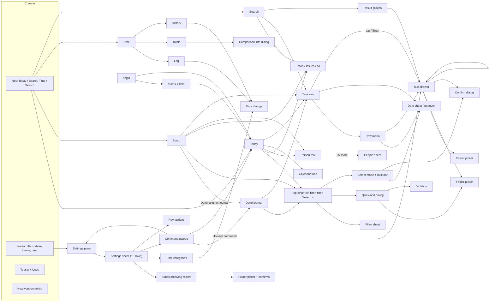

# UX surface map

The checklist of everything a person can see and do in task-os: every pane, drill-in, menu, sheet, dialog, gesture and key, with how it is reached, what is on it, what each control does and the decision behind it where one exists. [Views](views.md) tells the story of the main views in prose; this page is the exhaustive index, so a layout change can check every surface and not only the ones a reviewer happens to open. Behaviour that a surface only links to lives in its own doc (linked per entry).

**Keeping it true.** A change that adds, removes, renames or reshapes a user-visible surface (a pane, tab, sheet, dialog, popover, menu, menu item, Settings row, gesture or key) updates this page in the same change, with the entry's *why* when the choice was deliberate. The rule is in `CLAUDE.md`.

**Entry shape.** `ID` · *Reach* (how you get there) · *Holds* (what is on it) · *Does* (what its controls do) · *States* (empty, error, loading, gated) · *Why* (the decision). `Phone` and `Desktop` call out where the two renderings differ; a line without either holds for both.

## Contents

1. [Ground rules](#ground-rules) — input modes, layout bands, URL state, feature gating
2. [Surface graph](#surface-graph)
3. [Chrome](#chrome) · [Today](#today) · [Board](#board) · [Shared strip](#shared-strip-above-every-list) · [Row](#the-task-row) · [Drawer](#task-drawer) · [Time](#time) · [Search and palette](#search-and-command-palette) · [Journal](#done-journal) · [Settings](#settings) · [Sign-in](#sign-in-and-team-name)
4. [Overlay catalog](#overlay-catalog) · [Keyboard map](#keyboard-map) · [Deep links](#deep-links-and-url-state) · [Empty, error and loading states](#empty-error-and-loading-states)
5. [Where this map was checked](#where-this-map-was-checked)

## Ground rules

**Four destinations, one gear.** The nav is Today · Board · Time · Search. Settings is the header gear, one tap from every tab, and is not a tab. The Done journal is a pane with no tab. Time can be switched off (Settings → Available features), which removes its tab.

**Layout bands** (the same markup, three placements):

| Band | Condition | Nav | Lists | Task detail |
| --- | --- | --- | --- | --- |
| Phone | touch pointer, up to 520px | floating bottom pill, hidden under a modal | one column; rows run edge to edge | full-screen sheet |
| Narrow or mid window | a mouse below 1100px, or a touch device wider than 520px | an inline tab bar pinned at the top | one column | full-screen sheet below 1024px, side panel or split from 1024px |
| Wide | 1100px and up with a mouse | left rail | Board and Today span the window; Time, Search and Settings keep a 772px measure | side panel (Board), split pane (Today), detail pane beside the list (Settings) |

The 1024px breakpoint (side panel, split, a list scrolling inside its own box) is separate from the 1100px rail breakpoint, so a 1024 to 1099px window has the top bar and the split.

**Input modes.** A mouse or trackpad gets the completion circle and the **Move** verb on each row and right-click on a row. A touch screen has neither: a row swipes (right completes, left opens the date sheet) and the kebab holds everything else. The keyboard reaches every row action through keys and the palette, so no action is gesture-only. Drag-and-drop on the Board is mouse only.

**Gating.** Surfaces tagged for a feature block disappear when the block is off: Time (tab and Time categories row), Calendar lane (and Calendar row), Issue sync (and Issues row, drawer panel, issues scope), Email and folders (Capture, Email archiving, folder and email search), Local AI (Voice, AI Inbox triage, Triage), Mirror and backups. `Available features` is itself a Settings group.

**Who the viewer is.** On the install's own PC (loopback) the viewer is the install owner with no credential. Any other device signs in at `/login` with a token or password and is the member that credential names; with team mode on, a team password plus a picked name signs in instead. A request with no credential from another device is refused. Surfaces that depend on this: the person row, Owner select, Mine/Everyone, Sign out, the name picker.

**Where state lives.** The filter, scope, person pick and search query ride the URL (see [Deep links](#deep-links-and-url-state)). Per-device choices live in `localStorage`: theme, text size, last tab, Board mode, Mine/Everyone, row-action choices. Nothing about a person is stored in the browser except those labels.

## Surface graph

Reading it: every list view feeds the one task row; the row feeds the one drawer; every picker that chooses a folder is the same folder picker; every date choice goes through the one date sheet (a popover next to the row on a mouse, a sheet on the phone).

## Chrome

**CH-1 Header** — *Reach:* always on screen, above every pane. *Holds:* a glyph and title naming the view on screen, a status line beside it, the theme toggle, the Settings gear. *Does:* the gear opens Settings (any tab press leaves it); the toggle flips light and dark. *States:* the status line names exceptions per view: Today *2 overdue · 3 due today* (or a muted *Nothing due today*), Board *4 in Inbox · 3 overdue*, Settings what needs attention (*3 mails need you*, *Issue sync failing*, else *6 of 9 services on*). On an install with no tasks every pane's status reads *No tasks yet*, Settings included, and *Server unreachable* replaces it when the server cannot be reached. *Why:* one persistent header row rather than a heading per pane.

**CH-2 Nav** — *Reach:* always. *Holds:* four tabs with a glyph and label; the active one is tinted. *Does:* switches the pane; Arrow keys move between tabs. A deep link beats the remembered tab; the last tab is remembered per browser. *States:* Time absent when its block is off. *Why:* the fleet nav contract caps the bar at five; Settings is the rarely-used destination, so it is the gear.

**CH-3 Footer** — build line (identity of the running build), last child of the page, outside every card.

**CH-4 Toast** — *Reach:* after a user-initiated write or an error; passive status renders inline instead. *Holds:* one message at a time, pinned above the nav, with an optional **Undo (Z)** button. *Does:* Undo writes the inverse change; it and the `z` key expire together after ten seconds. Bulk results name any task that failed. *States:* neutral, or tinted for an error.

**CH-5 New-version notice** — a banner offering **Reload** when the server moved to a newer build while the page stayed open (an installed phone app in memory across a restart). It is dismissible and never reloads by itself, so a typed draft survives.

**CH-6 Install shell** — the page is an installable app (manifest, standalone display); the installed app adds a strip above the status bar and keeps the nav at the bottom edge.

## Today

*Reach:* nav · first visit lands here on every pointer · `#` nothing. *Why it leads:* what is due is the question the app is opened for.

**TD-1 List** — *Holds:* top strip ([ST-1](#shared-strip-above-every-list)), person row when there are two or more members, **Tasks · Issues · All**, then the calendar lane and four horizons. *Does:* the horizons are **Due** (overdue first, then today; no heading, the header names it), **Soon** (tomorrow to a week out, open), **Later** and **No date** (folded until opened; a text filter opens them; each shows only when it holds something). Inside a horizon rows run by due day, no project first, project A–Z, title. *States:* empty install shows *Add your first task* with an **Add a task** button; a filter with no match shows an empty line; counts sit on the disclosure headers. *Desktop:* the list scrolls inside its own box under the strip at 1024px and up.

**TD-2 Detail split** — *Desktop (1024px and up):* the right half is the [drawer](#task-drawer), never empty while a task is due: arriving on Today shows the first due task without writing a `#task/` link. With nothing due, or after closing, it reads *Select a task to see its details*. Leaving Today closes it. *Phone:* the drawer is a full-screen sheet.

**TD-3 Calendar lane** — *Reach:* above the horizons when the calendar block and an ICS address are configured. *Holds:* an all-day band of chips, timed events with their span, an event count. *Does:* read-only; nothing is written back. *States:* a failing feed shows a notice titled by cause (*address refused*, *unreachable*, *did not answer in time*, *feed unreadable*) with the time it began failing and the last good copy kept; a feed that parses but has events it could not evaluate says how many (*N recurring event(s) could not be checked — open the calendar itself*). Settings → Calendar holds the status and a refresh. *Why:* your real calendar beside the task list, without any write path.

## Board

*Reach:* nav. Two-dimensional, so it spans the window on desktop.

**BD-1 Mode line** — under the strip: person row, scope, then **Week · Status** (remembered per device), and in Status mode while the Inbox holds tasks, **Triage** (AI suggestions for every Inbox task; disabled with its reason on hover while Local AI is off or a run is in flight).

**BD-2 Week lanes** — *Holds:* **Today** (overdue included) · **Tomorrow** · **This week** · **This weekend** · **Next week** · **Later** (no-date tasks close it under a *No date* sub-heading). *Does:* drag a row onto a lane to re-date it to that lane's first day (toast and Undo, nothing but the due date changes). *Desktop:* lanes side by side, each scrolling under a sticky header with its count; an empty lane collapses to its header and stays a drop target. *Phone:* one list of lane sections, rows swipe, no drag. *Why:* every date belongs to exactly one lane, so *This week* and *This weekend* show only while they have days left after tomorrow.

**BD-3 Status columns** — **Inbox · Todo · Standby · Done today**; drag a row to change its status; ticking statuses in the filter sheet hides the other columns. The Done column head carries a **journal** link ([JN-1](#done-journal)). *Phone:* a one-column scroll-snap carousel whose count strip (*Inbox 4 · Todo 30 …*) is also the column switcher; no row swipe here because the columns already swipe sideways.

**BD-4 AI suggestion strip** — *Reach:* under an Inbox row after Triage staged a suggestion. *Holds:* a one-line summary (parent · priority · due · person) with its reason on hover and **Accept** and **Reject** icon buttons. *Why:* nothing is applied until accepted.

**BD-5 Row panel** — *Desktop:* opening a card shows the drawer as a 440px side panel beside the lanes. *Phone:* full-screen sheet.

## Shared strip above every list

**ST-1 Top strip** — on one line: the live **text filter** (placeholder carries the count, *Filter 12 tasks…*), the **filter button** (carries how many filters are on; its name spells them), **Select**, and **+**. Today, Board and the Done journal carry it; Search carries its own box and the filter button inside it.

**ST-2 Filter sheet** — *Reach:* filter button. *Holds:* **sort** (Due · Priority · Modified · Created · Title), **status** ticks (including `done` and `cancelled`), **project**, **person** ticks, **due window**, **modified window** (including *untouched over 30/60/90 days*, the stale pass), **Clear** (only while something is on), **Done**. *Does:* applies live; the state is the URL. Clear leaves the scope and person row alone. *Phone:* a full-screen sheet with ticks two to a line. In the journal, status, due, modified and sort are hidden.

**ST-3 Scope switch** — **Tasks · Issues · All** under the strip on Today, Board and Search (`?scope=`). Tasks (default) leaves out issues the forge sync brings in.

**ST-4 Person row** — *Reach:* two or more members. *Holds:* **Mine** · each member · **Everyone**; with more than three other members the row keeps the picked and recent ones and folds the rest into **+N more**. *Does:* one tap picks one person; **+N more** opens **ST-5**. Mine and Everyone are per device (`?whose=everyone`); picked members ride `?owner=`. Search ignores the row and always covers everyone. *Why:* each phone signs in as its own member, so Mine needs no picker step.

**ST-5 People sheet** — *Reach:* **+N more**. *Holds:* a name filter, one tick per member, **Done**. The only place several people are picked at once; an emptied set falls back to Mine.

**ST-6 Select mode and bulk bar** — *Reach:* **Select**. *Does:* every row becomes a tick target (drag and phone swipe off; one selection shared across Today and Board). With one or more ticked the bar replaces the strip: *N selected* · **Move** (date sheet, [RW-5](#the-task-row)) · **Set status…** (native select: inbox, todo, standby, complete, done, cancelled) · **Set owner…** (two or more members) · **Delete** (confirm names the count, projects whose children go too, and synced issue tasks the next sync would bring back) · **Leave select mode**. Escape leaves. *States:* a task that fails in a bulk write is named in the toast.

**ST-7 Quick-add dialog** — *Reach:* **+** · palette *New task* · no-tasks button. *Holds:* the title line (natural language, parsed on the server: trailing date, `starts`, `#id` or `› parent`), a **Dictate** mic, then description, due, starts, status, folder (typed or **Find in folder index**), one link (URL and label). The parsed parent shows as a chip, a parent that matches nothing as a red chip and nothing is created. *Does:* **Add** or Enter creates and focuses the row; Escape, the backdrop and × discard. *States:* dictation shows listening, settling and unreachable-service states. See [Views](views.md#views).

## The task row

One row in Today, Board, Search task hits and the journal.

**RW-1 Row** — leading **project pill** (Today and Board) · one-line title · one meta line (context name, then due, exception chips, counts). Tapping anywhere opens the drawer. *Why:* nothing on the meta line is a target; 60px a row.

**RW-2 Completion circle** — *Mouse only.* Completes an open task (a recurring one rolls) or reopens a closed one, with Undo.

**RW-3 Move verb** — *Mouse only, open rows outside Board lanes.* A calendar glyph button; opens the date popover. *Why:* re-dating is most of what is done to a task.

**RW-4 Row menu (⋯)** — *Reach:* kebab · right-click · `.` · the menu key on a focused row. *Holds:* the actions in the order set in Settings → Row actions: Complete or Reopen, **Move…**, Status (inbox, standby, cancelled, todo as it applies), **Cycle priority**, Due tomorrow, Due next week; then, when the task has them, **Open folder**, **Open AI conversation** (and **Resume in CLI** for a resumable session), **Open issue `repo#N`**; last **Open details**. *Why:* one table of actions (`actions.js`) feeds the menu, the keys, the palette and the swipes.

**RW-5 Date sheet / popover** — *Reach:* the Move verb, a swipe left, the menu's Move…, `d`, Select mode's Move, the drawer's quick moves. *Holds:* **Tomorrow · This weekend · Next week · Today**, each with the date it lands on, then **Pick a date…** (a native date field) and **No date**. *Desktop:* a popover next to the row. *Phone:* a bottom sheet (a dialog). One pick moves the task and leaves it on the list, with Undo.

**RW-6 Swipe** — *Touch only, open rows in a vertical list.* Right completes, left opens the date sheet by default; both are configurable. Starts away from the screen edge, locks sideways, commits past 96px or a quick flick, never in the phone Board's Status carousel. Revealed label turns to *Release to …* when armed.

## Task drawer

*Reach:* a row tap or Enter · menu *Open details* · `#task/<id>` · Today's auto-opened first task. *Desktop:* side panel or split pane; *Phone:* full-screen. Escape or **Close** closes it (then leaves Select mode).

**DR-1 Head** — breadcrumb (clickable), **Change parent** (opens [DR-9](#task-drawer)), **Remove parent** (only with a parent; no confirm, no Undo), **Close**, and the task's number.
**DR-2 Title** — an editable field with a visible boundary.
**DR-3 Due + quick moves** — a date field with a calendar button, then *Tomorrow · This weekend · Next week · Today* with their dates. Due comes first because most edits push it out.
**DR-4 Status, Priority, Owner** — native selects; Owner only with two or more members (an `owner old → new` activity row names who).
**DR-5 Links** — pills for the folder, the issue and every link; an AI-conversation URL wears the bot chip; a folder chip is a `taskos://` link opened by the per-PC opener (the phone shows the path to copy).
**DR-6 Description** — markdown, a pencil toggles edit and preview.
**DR-7 Comments** — newest first, a composer (**Send**, Ctrl+Enter), per comment a **pencil** (edit in place, Ctrl+Enter saves, Escape cancels) and a **trash** (asks first, no undo); URLs, `{folder}` refs and `repo#N` render as chips.
**DR-8 Activity** — `field old → new · actor · time`; issue-sync rows fold behind *Show N sync updates*.
**DR-9 Parent picker** — a centred card on desktop, full screen on the phone: a filter field (*Filter N open tasks*) over every open task in tree order, indented, each with its path; the task itself, its descendants and closed tasks are not offered. Tap or Enter on the first match files it; a cycle is refused with a toast. The one way to re-parent.
**DR-10 More fields** — a disclosure closed by default whose summary names what is set (*starts in 3d · repeats · 1 blocker*); once opened it stays open for the page's life. Inside: **Starts** (a date; the only place the start date is edited), **Repeat** (never/daily/weekly/monthly, every N, the fixed day), **Person** (the contact a task is about, not the owner), **Code**, **Folder** (typed ref or **Find in folder index**), **Edit links** (label edit, remove, **Add link**), **Blocked by** (**Add blocker**), **Children** (click to navigate, **Add child**), and the **Issue panel**.
**DR-11 Issue panel** — a linked issue shows its provider glyph, `repo#N`, state, labels, last-synced time, **Sync now** and **Unlink**; a plain task shows **Create issue** (repo from the last-seen list or typed) and **Link existing** (`owner/repo#N` or URL). Gone when Issue sync is off. See [Issues as tasks](issues-as-tasks.md#issues-as-tasks).
**DR-12 Delete task** — last and quiet. A confirm names the task and its subtree, says there is no trash and no undo, and for a synced task with an open issue warns the next sync recreates it. A toast says how much went.

**FP-1 Folder picker** — a search-as-you-type list over the folder index with **Find in folder index** as its opener; Enter attaches the first hit, Escape closes the picker first. Shared by the drawer, the quick-add dialog and Email archiving's file-it panel. *States:* the index not configured or unavailable says so instead of listing nothing.

## Time

*Reach:* nav. Hidden when its block is off. One-dimensional (772px measure). **Log · Totals · History** segment under the header. See [Time tracking](time-tracking.md#time-tracking).

**TM-1 Log** — *Holds:* *Today so far* (per person, with each person's running state), **Start a timer** (Recent first, then each area with its categories as large tiles, each with its subtitle), **Add time already spent**. *Does:* tapping a tile starts a timer; with one running, a **Stop and start …** choice replaces the timer in one call. A running timer's tile reads *Running now* and the card shows **Stop and save** and **Discard** (immediate, with a *Timer discarded* toast and no undo). Past the long-timer limit the card asks whether the timer was forgotten and lets you correct the minutes. A running timer is the server's: a reload or another device shows the same one.
**TM-2 Totals** — *Holds:* **Today · 7 days · 30 days · All**, an **Area** filter, **Me · Everyone** when there are several people, a total, per-category bars, and on the compare area with two or more people the head-to-head, the split bar, days logged per person, a **How the comparison works** info dialog and **Guess your share** (**Lock in**; the other guess stays hidden until yours is locked), **Download CSV**. People differ by initials and fill, never by colour.
**TM-3 History** — every entry by day with its clock range or, for an imported entry, its duration; each row's **More actions** holds **Edit**, **Start again** and **Delete** (confirmed).
**TM-4 Time dialogs** — **Add time already spent / Edit entry** (person, category, day with Today and Yesterday, start, minutes with 15/30/45/60/90/120 chips, note), **A timer is running** (the switch choice), text prompts and option pickers for categories, and a plain info dialog. Closed by × or Escape.
**TM-5 Person picker** — on first visit when a team sign-in names nobody in the install, a one-time question of who is logging, kept in memory only.

## Search and command palette

**SR-1 Search tab** — *Reach:* nav · `#search` · Go to Search. *Holds:* an auto-focused box (a filter button and the scope switch under it), a count, and results. A group appears only for a kind with hits (Tasks, Folders, Emails, Issues), open, under an uppercase header with its count; every other kind folds into one line (*No matches in …*, *Not set up: …*). Task hits are the standard row plus the matched snippet, exact first, then *Partial matches*, then *Similar matches*; other hits are a title and one meta line whose single control opens them. *States:* folder-explorer answering badly is its own line per kind, never *No matches*: *unreachable*, *indexing*, *not set up*, *failed*, with the reason; a broken index is shown in the danger tone. *Keys:* Down from the box focuses the first row, Up and Down move, Enter opens, Escape or `/` returns to the box. *Why:* the 200ms debounce and the *`?q=`* URL make a search shareable.

**SR-2 Command palette** — *Reach:* Ctrl+K or Cmd+K from any tab · Settings → Command palette → **Open command palette** (the phone's only way; the header has no button). *Holds:* a box; plain text jumps to a task (top eight: title, breadcrumb, status); `>` lists commands. Commands: *New task* · the row actions for the focused or ticked task (first while one is targeted) · *Go to Today / Board / Time / Archive / Search / Settings* · *Journal* · *Filter: status inbox / todo / standby / done / cancelled* · *Filter: clear* · *Sync issues* · *Export mirror* · *Open folder of current task* · *Toggle theme* · *Sign out*. Commands of a switched-off block are omitted. Up/Down move, Enter runs, Escape closes. *Phone:* a full-width sheet.

**SR-3 Keyboard shortcuts sheet** — *Reach:* `?`. A list of every key (below), including the ones the palette shows with their key.

## Done journal

**JN-1 Journal** — *Reach:* the Board's Done column head (**journal**) · palette *Journal* · `#journal`, `#journal/task/<id>`. *Holds:* the shared text strip and filter sheet (project, person, text), a **Show cancelled** toggle, closed tasks newest day first under one heading per local day (*Yesterday · Tue 1 Sep · 2 done*), cancelled ones muted, **Show the week before** to widen by seven days. *Does:* the filled circle reopens a task in place; the row opens the drawer. *States:* it says it has reached the end only once the server confirms nothing closed earlier; an install with nothing closed says so. Any tab press leaves. *Why:* a reading surface (the answer to "what happened this week"), not a tab.

## Settings

*Reach:* the header gear · palette *Go to Settings* · `#settings`. A pane with no tab. Six inset groups; each row shows its lead glyph, label, its current value (in the attention or danger tone when it is an exception) and a chevron. A row opens its **sheet**: *Desktop (1024px and up)* the detail pane beside the list at 1 : 1.5 with the row tinted (the Email archiving report spans the window); *Phone* full-screen with **×** and **Done**. `#settings/<row>` keeps a sheet across reload; Back closes it.

| Group | Row | Value shown | Sheet holds |
| --- | --- | --- | --- |
| This device | **Text size** | Small / Default / Large (in place, no sheet) | a three-way control; scales rem-based type, not rows or icons |
| | **Row actions** | *Default* | a select for **swipe right** and one for **swipe left** (any action or nothing), then every row action with **Show in the menu**, **Move up**, **Move down**, and **Reset to the defaults**; an action a swipe runs always stays in the menu |
| | **Command palette** | *Ctrl+K* | a line of explanation and **Open command palette** |
| | **Phone access** | the client (*this PC* or the member) | who you are signed in as, whether HTTPS is on, whether a token and a password are set (and the script that sets them), the team line *you are X · change name* with team mode, install hints for iOS and Android, **Sign out on this device** (only for a cookie session) |
| Sync | **Issues as tasks** | on / off / failing | provider, repos, next and last pass and result, **Sync now** |
| | **Calendar** | on / error / unknown | the feed host only (never the address), refresh cadence, last fetch, failure cause, **Refresh now** |
| Email | **Capture into Inbox** | on / off | the last flagged-mail pass and its state, **Check now** |
| | **Email archiving** | off / ready / running / *N need you* | **Archive Inbox now**, a first-N bound, the archiver state, the run picker, **Accept all (N)**, the run report (below) |
| Tools | **Time categories** | *4 areas · 13 categories* | areas and their categories; **Add area**; per area **Rename · Add category · Move up/down · Archive**; per category **Edit · Move up/down · Move to another area · Archive** and **Delete** only while nothing points at it; dialogs carry the subtitle field |
| | **Search** | indexed / not set up | the four indexes with their state and reason |
| | **Folder opener** | on / not installed | the install command with **Copy command**, whether the opener is installed on this PC, and a disclosure *Uninstall · folder paths for each PC* with **Copy** |
| | **Voice quick-add** | on / off | the transcription chain, its state and reason |
| | **AI Inbox triage** | on / off | the local-AI state and reason, what triage sends and that suggestions stay staged |
| Available features | one switch per block (Time tracker · Calendar lane · Issue sync · Email and folders · Local AI · Mirror and backups) | on / off, or *on, unavailable here: reason* | a switch that applies at once, no reload; a block whose dependency is missing says why |
| This install | **Your name** | the saved name or *not set* | a field and **Save name**; blank clears it, the line under it shows the name an unsigned write uses |
| | **Database** | schema version | where config and data live, the schema version |
| | **Mirror and backup** | off / on | what is exported and backed up, import conflicts with **Clear import conflicts** |

**ST-A Email archiving report** — *Reach:* Settings → Email archiving · palette *Go to Archive*. *Desktop:* a table (subject with who and when · destination as its last three components · files as chips, the first shown and *+N more* · confidence · why · state). *Phone:* cards, with the review levels behind **Review**. Each row's **⋮** offers exactly what its state allows: **Accept** (a mail that needed a human), **Move to… / File it…** (the ranked candidates or any folder through the folder picker, with an optional hint the next run remembers), **Retry** (the file was written before Outlook refused the move), **Revert** (files deleted, mail back to the Inbox; only a filed row). A run picker lists earlier runs and **Accept all (N)** clears a reviewed batch; anything touching files asks first. *States:* *No run yet*, running (the run button reads *Archiving…* and is disabled), not configured with the reason, a run that failed with its reason. See [Archive the Inbox](inbox-archive.md#archive-the-inbox).

## Sign-in and team name

**LG-1 Sign-in** (`/login`, public) — a card with one field (*Token or password*) and **Sign in**; a wrong secret says *wrong token or password*. A token or password sets a 90-day cookie. With team mode on, the team password signs in and leads to **LG-2**. Not reached on the install's own PC, which needs no credential.

**LG-2 Name picker** — *Who are you?* with one button per member (initials and name, the first focused). It sets a label recorded on comments and changes, never a credential; *change name* in Settings → Phone access returns here.

## Overlay catalog

| Overlay | Kind | Opened by | Closed by |
| --- | --- | --- | --- |
| Filter sheet | modal sheet | filter button | **Done**, ×, Escape |
| People sheet | modal | **+N more** | **Done**, ×, Escape |
| Quick-add | modal | **+**, palette, empty-state button | **Add**, ×, Escape |
| Command palette | modal | Ctrl+K, Settings row | Escape, backdrop |
| Keyboard shortcuts | modal | `?` | Escape, × |
| Confirm | modal | every delete, bulk delete, archive file actions, time delete | **Cancel**, Escape |
| Parent picker | modal card | **Change parent** | Escape, backdrop |
| Time dialogs | modal | tiles, history menu, categories | ×, Escape |
| Date sheet | sheet on touch, popover on mouse | Move paths | pick, Escape, outside tap |
| Row menu | popover | kebab, right-click, `.` | Escape, outside tap, any pick |
| Settings sheet | detail pane or full-screen | a Settings row | **Done**, ×, Back |
| Task drawer | side panel, split or full-screen | a row | Close, Escape |
| Toast | transient | a write | timer, ×, Undo |

A modal hides the phone's floating nav while it is open.

## Keyboard map

| Key | Does |
| --- | --- |
| Tab / Shift+Tab | moves between rows and controls |
| Enter | opens the focused task |
| Space | ticks the row while Select mode is on |
| Ctrl+K / Cmd+K | the command palette |
| Esc | closes the topmost overlay, then the drawer, then leaves Select mode |
| `e` | complete (a recurring task rolls) |
| `1` `2` `3` | status inbox, todo, standby |
| `t` `w` | due tomorrow, due next week |
| `d` | the date sheet (Move…) |
| `p` | cycles priority |
| `z` | undo the last row action |
| `.` or the menu key | the row menu |
| `?` | the shortcuts sheet |

Row keys act on the focused row, or on the whole selection when tasks are ticked, and never fire while focus is inside a popover, menu, folder picker, toast or the bulk bar. Search, the palette, the parent picker, the folder picker and the comment composer have their own keys (listed on their entries).

## Deep links and URL state

| Form | Opens |
| --- | --- |
| `/` | the last tab, or Today on a fresh browser |
| `#task/<id>` | the drawer on that task |
| `#journal` · `#journal/task/<id>` | the Done journal, with the drawer |
| `#search` · `?q=<text>` | the Search tab and its query |
| `#settings` · `#settings/<row>` | Settings, a sheet open |
| `?status=&project=&sort=&updated=&due=&scope=&whose=&owner=&person=` | the same filtered view on every list tab |
| `/login?next=<path>` | sign-in, then back to the path |

An old `#table`, `#tree` or stored `table` / `tree` tab lands on Today; an old Archive tab link lands on Settings → Email archiving. Reading a link never rewrites the per-device Mine/Everyone pick.

## Empty, error and loading states

| Where | State | What shows |
| --- | --- | --- |
| Today, Board | no tasks at all | *Add your first task* with **Add a task**; every header reads *No tasks yet* |
| Today (desktop) | nothing due or nothing selected | *Select a task to see its details* |
| Today | nothing due | header *Nothing due today*; horizons still list |
| Calendar lane | feed failing or partly unreadable | titled notice with cause and time; last good copy kept |
| Board | Triage unavailable | button disabled, reason on hover |
| Journal | nothing closed | says so and that nothing closed before the window |
| Time | nothing logged yet | the start list still works; Totals keep the comparison and guess card and show an empty state for the per-category bars |
| Search | an index off or failing | named, folded or in the danger tone, never an empty result |
| Settings | a service failing | its row value in the danger tone and the header line names it |
| Email archiving | no run, running, failed, not configured | the empty line, *Archiving…* with the button disabled, the reason |
| Any page | server unreachable | the header line and toasts report it |
| Sign-in | wrong secret | *wrong token or password*, nothing stored |

## Where this map was checked

Every surface above was opened on a disposable instance seeded only from the synthetic fixture (`tests/fixtures/seed.py`), with local fakes for the calendar feed, the folder service and the archiver, plus a second instance with team mode and seven members, and a third with no data and failing services. Desktop was a 1440 to 1920px window with a mouse. The phone was a 390 by 844 touch-emulated page. The e2e suite's per-story walks (`tests/e2e/`) cover the same surfaces with screenshots.

Not driven live in that walk, only read from the code and the docs: drag-and-drop between Board lanes (mouse only), the real feel of a swipe (the wiring was driven with synthetic touch events), voice dictation (needs a microphone and a transcription service), AI triage suggestions (needs the local model), creating and linking real forge issues, and a real mirror and backup folder (blanked on a disposable instance by construction).
